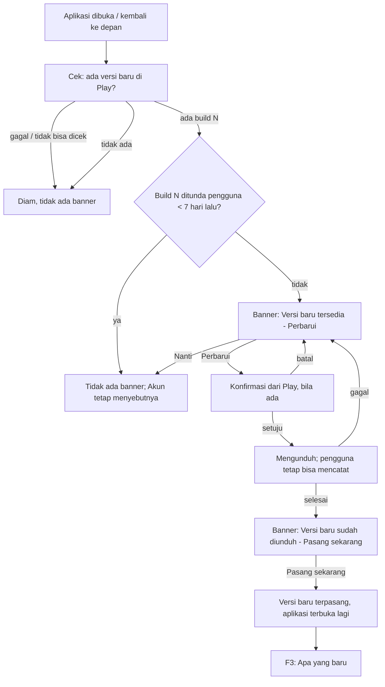

# Pengumuman pembaruan: versi baru dari Play Store dan pembaruan kecil Shorebird

**Tanggal:** 11 Oktober 2026.
**Status:** Diputuskan pemilik 15 Okt 2026 (§12). Kode T-20.1–T-20.7 selesai
dan sudah di `main` (ada di build `0.6.0+12` dan `0.7.0+13`); sisa T-20.8,
verifikasi di perangkat lewat jalur tes Play. Keputusan teknisnya di
[ADR-039](../../02-architecture/adr/0039-pengumuman-pembaruan-play-shorebird-dan-catatan.md)
(Accepted 15 Okt 2026); tugasnya Fase 20 di TASK_LIST. Proses menulis dan
menerbitkan catatan "Apa yang baru":
[RELEASE_NOTES.md](../../03-release/RELEASE_NOTES.md).
**Berkaitan:** [ADR-023](../../02-architecture/adr/0023-identitas-opsional-firebase-auth-analitik-crashlytics.md)
(Analytics/Crashlytics), T-8.7 (rilis Android dan Shorebird),
[PLAY_DATA_SAFETY.md](../../03-release/PLAY_DATA_SAFETY.md), skill
`release-email` (catatan rilis untuk penguji).

Dokumen ini merancang perilaku, alur, aturan, dan teks: apa yang dialami
pengguna. **Cara teknisnya tidak diputuskan di sini**: mekanisme pengecekan
dan pemasangan versi Play Store, cara membaca keadaan Shorebird, dan tempat
menyimpan catatan "Apa yang baru" dipilih engineer di ADR-039 (ringkasannya
di §13). Rupa visual
mengikuti komponen yang sudah ada (banner perhatian, baris setelan, lembar);
yang belum ada ditandai "perlu rupa dari ui-ux-designer".

## 1. Ringkasan keputusan

1. **Dua mekanisme, satu bahasa untuk pengguna.** Pengguna tidak perlu tahu
   Play Store atau Shorebird. Rilis toko disebut **versi baru**, tambalan
   Shorebird disebut **pembaruan kecil**. Keduanya diumumkan di tempat yang
   sama: banner di Beranda dan baris **Versi aplikasi** di Akun.
2. **Versi baru dari Play Store bisa dipasang dari dalam aplikasi**, dengan
   ketukan sesedikit mungkin, tanpa dipaksa, dan sebisa mungkin tanpa
   menghentikan pengguna yang sedang mencatat. Pengguna bisa menundanya
   (KT-U1).
3. **Pembaruan kecil yang sudah siap diumumkan sekali** di Beranda, beserta
   cara memakainya (tutup lalu buka lagi aplikasi) (KT-U2).
4. **"Apa yang baru" tampil sekali** sesudah versi atau pembaruan kecil yang
   punya catatan terpasang, lalu bisa dibuka lagi dari Akun (KT-U3).
   Catatan tersedia untuk versi baru maupun pembaruan kecil, dan **wajib
   ada untuk setiap build yang dipublikasikan** (keputusan pemilik 15 Okt
   2026).
5. **Tidak pernah mengganggu pencatatan.** Pengumuman hanya di Beranda dan
   Akun, tidak pernah di tengah Catat, suara, atau lembar lain; tidak muncul
   selama onboarding atau tur; tidak menyingkirkan banner kotak masuk
   notifikasi (keduanya bisa tampil bersama, B-2); dan diam saja saat luring
   atau saat pengecekan gagal.
6. **Tanpa data keuangan keluar perangkat.** Data teknis yang keluar karena
   fitur ini disebut di ADR-039 dan di formulir Keamanan Data (§9).

## 2. Masalah dan bukti

- **Penguji closed testing tidak tahu ada versi baru.** Play Store
  memperbarui aplikasi di latar hanya bila pembaruan otomatis menyala dan
  ponsel memenuhi syaratnya (Wi-Fi, mengisi daya, aplikasi tidak sedang
  dipakai). Banyak penguji tetap di versi lama berhari-hari, sehingga
  laporan mereka sering tentang bug yang sudah diperbaiki. Bukti: permintaan
  pemilik 11 Okt 2026; email rilis (skill `release-email`) sejauh ini
  satu-satunya cara memberi tahu, dan email tidak dibaca saat aplikasi
  dibuka. *Asumsi* sampai diukur: belum ada data berapa persen penguji di
  versi terbaru (lihat §3, ukuran keberhasilan).
- **Tambalan Shorebird tidak terlihat sama sekali.** Shorebird mengunduh
  tambalan di latar saat aplikasi dibuka, dan tambalan baru dipakai pada
  pembukaan **berikutnya**. Pengguna yang jarang menutup aplikasi bisa lama
  memakai kode lama tanpa tahu, dan tidak pernah tahu apa yang berubah.
- **Pemilik dan penguji tidak bisa melihat versi persis yang terpasang.**
  Layar Akun belum menampilkan nomor versi, apalagi nomor tambalan, sehingga
  laporan bug tidak bisa dicocokkan dengan kode.

## 3. Tujuan, non-tujuan, dan ukuran keberhasilan

**Tujuan**

1. Pengguna tahu ada versi baru dan bisa memasangnya tanpa keluar ke Play
   Store, dalam dua ketukan dari Beranda.
2. Pengguna tahu pembaruan kecil sudah siap dan cara memakainya (tutup lalu
   buka lagi aplikasi).
3. Pengguna tahu apa yang berubah, dalam bahasa manfaat, sekali saja.
4. Pemilik dan penguji bisa membaca versi dan nomor pembaruan kecil yang
   terpasang di Akun, dan nomor itu ikut terkirim ke Analytics dan
   Crashlytics.

**Non-tujuan (R1)**

- Pembaruan paksa atau "versi minimum" (B-39).
- iOS: aplikasi belum dirilis di App Store (B-39).
- Memberi pengguna pilihan "jangan unduh pembaruan kecil" atau memilih
  jalur uji.

**Ukuran keberhasilan**

| Ukuran | Target | Cara mengukur |
|---|---|---|
| Pengguna aktif di versi toko terbaru | ≥80% dalam 7 hari sesudah dipublikasikan | Dimensi bawaan `app_version` Analytics |
| Pengguna aktif di pembaruan kecil terbaru | ≥80% dalam 3 hari sesudah tambalan dirilis | Properti pengguna `patch_number` (baru, §8) |
| Banner versi baru berujung dipasang | ≥50% dari `update_banner_shown{kind: store}` | `update_banner_action{action: install}` / `shown` |
| Laporan bug penguji yang menyebut versi | Setiap laporan bisa dicocokkan ke versi + tambalan | Crashlytics custom key `patch_number`, baris Versi aplikasi di Akun |

## 4. Pengguna dan skenario

Angka versi memakai skema sekarang: `0.5.0+6` = nama versi `0.5.0`, nomor
build (versionCode Play) `6`.

**S1 — Versi baru di Play Store.** Rani penguji closed testing, terpasang
`0.5.0+6` tanpa tambalan. Pemilik mempublikasikan `0.6.0+7` di jalur closed
testing. Senin pagi Rani membuka aplikasi untuk mencatat kopi Rp25.000.
Beranda menampilkan banner "Versi baru tersedia. [Perbarui]". Rani
mengabaikannya dan mencatat kopi lewat Catat seperti biasa (banner tidak
mengganggu). Siang hari ia mengetuk **Perbarui**, Play menampilkan dialognya
sendiri, Rani setuju, unduhan berjalan di latar. Beberapa menit kemudian
banner berganti "Versi baru sudah diunduh. [Pasang sekarang]". Rani
mengetuk, aplikasi tertutup sebentar dan terbuka lagi di `0.6.0+7`, lalu
lembar **Apa yang baru di versi 0.6.0** tampil sekali. Saldo dan transaksi
kopi Rp25.000 tetap ada.

**S2 — Pembaruan kecil Shorebird.** Budi terpasang `0.6.0+7` tambalan 0.
Pemilik merilis tambalan 1 (perbaikan perhitungan sisa anggaran). Saat Budi
membuka aplikasi, Shorebird mengunduh tambalan 1 di latar. Begitu selesai,
Beranda menampilkan "Pembaruan kecil siap. Tutup lalu buka lagi aplikasi
untuk memakainya. [Oke]". Budi mengetuk **Oke**, banner hilang dan tidak
muncul lagi untuk tambalan 1. Malamnya Budi menutup aplikasi dari daftar
aplikasi terakhir dan membukanya lagi; kini berjalan tambalan 1, dan lembar
**Apa yang baru** menampilkan "Sisa anggaran kini dihitung benar saat
transaksi dipindah ke pos lain."

**S3 — Catatan tidak tersedia.** Setiap build yang dipublikasikan wajib
punya catatan (keputusan pemilik 15 Okt 2026; ditegakkan CI, ADR-039 §3.3),
jadi keadaan ini hanya terjadi bila catatannya belum bisa didapat di
perangkat (luring, Remote Config belum terambil): banner tetap tampil (tidak
bisa tahu isinya sebelum terpasang, §6 B-9) dan lembar Apa yang baru ditunda
sampai catatannya ada (§11), bukan dilewati.

**S4 — Keduanya ada.** Citra di `0.5.0+6` tambalan 1, tambalan 2 sudah
terunduh, dan `0.6.0+7` juga tersedia di Play. Beranda hanya menampilkan
banner **versi baru** (versi toko sudah memuat semua perbaikan; tambalan
untuk build lama tidak berguna lagi sesudah versi baru terpasang).

**S5 — Luring.** Dodi di pesawat, membuka aplikasi untuk mencatat makan
Rp58.000. Pengecekan gagal diam-diam; tidak ada banner, tidak ada pesan
galat. Akun menampilkan versi yang terpasang saja.

## 5. Alur pengguna

### F1. Versi baru dari Play Store (Android)

1. Titik masuk: Beranda (banner) atau Akun → Versi aplikasi.
2. Target ketukan: **Perbarui** → (konfirmasi Play bila mekanismenya
   memintanya) → **Pasang sekarang**. Paling banyak dua ketukan di
   aplikasi. Bila mekanisme pembaruan tidak mendukung unduh di
   latar, keadaan "mengunduh" dan "sudah diunduh" boleh tidak ada; syarat
   yang tetap berlaku: tidak memaksa, bisa ditunda, dan tidak menghilangkan
   data.
3. Banner punya tombol tutup **Nanti** pada keadaan "tersedia". Pada keadaan
   "mengunduh" tidak ada tindakan; pada "sudah diunduh" tidak bisa ditunda
   (unduhan sudah terjadi, memasangnya tinggal satu ketuk) tetapi tidak
   memaksa.
4. Jalan pulang: batal di konfirmasi → kembali ke "tersedia"; unduhan
   gagal → kembali ke "tersedia" tanpa pesan galat panjang; aplikasi
   ditutup saat mengunduh → saat dibuka lagi, keadaan yang benar tampil.
5. Tidak bisa dicek (mis. aplikasi tidak dipasang dari Play) → diam; Akun
   hanya menampilkan versi.

### F2. Pembaruan kecil Shorebird

1. Pembaruan kecil diunduh tanpa campur tangan pengguna (perilaku sekarang;
   engineer boleh mengubah cara kerjanya selama hasil di bawah tetap).
2. Begitu ada pembaruan kecil yang siap dipakai pada pembukaan berikutnya
   dan belum pernah diumumkan → banner "Pembaruan kecil siap. Tutup lalu
   buka lagi aplikasi untuk memakainya. [Oke]".
3. **Oke** atau menutup banner → nomor tambalan itu tercatat sudah
   diumumkan; banner tidak muncul lagi untuk nomor itu. Akun tetap
   menyebut "Pembaruan kecil siap, buka ulang aplikasi".
4. Pengguna menutup dan membuka lagi aplikasi → tambalan berjalan → F3.
5. Keadaan tidak bisa diketahui (mis. build debug) → diam.

### F3. Apa yang baru

1. Saat aplikasi dibuka, bandingkan **versi terakhir yang dilihat**
   (build, tambalan) dengan versi yang berjalan.
2. Pemasangan pertama (belum ada versi terakhir) → simpan versi sekarang
   tanpa menampilkan apa-apa; pengguna baru melihat onboarding, bukan
   catatan perubahan.
3. Versi berjalan lebih baru → kumpulkan catatan untuk semua (build,
   tambalan) yang lebih baru dari versi terakhir dan paling baru dari versi
   berjalan. Ada catatan → lembar **Apa yang baru** di Beranda, sekali.
   Tidak ada → tidak tampil apa-apa. Dalam dua kasus itu versi terakhir
   diperbarui ke versi berjalan.
4. Lembar menunggu bila onboarding atau tur spotlight sedang berjalan, dan
   tampil pada pembukaan Beranda berikutnya.
5. Akun → **Versi aplikasi** → membuka daftar semua catatan (terbaru di
   atas), kapan saja.

### F4. Versi aplikasi di Akun

Baris **Versi aplikasi** di grup paling bawah layar Akun:

- Nilai: "0.6.0 (7)" atau, bila tambalan berjalan, "0.6.0 (7), pembaruan 1"
  (KT-U4).
- Keterangan keadaan di bawahnya, satu dari: **Terbaru** (tidak ada apa-apa
  dan pengecekan Play berhasil), **Versi baru tersedia**, **Mengunduh versi
  baru**, **Versi baru sudah diunduh**, **Pembaruan kecil siap, buka ulang
  aplikasi**, atau kosong (tidak bisa dicek: luring, bukan dari Play).
- Ketuk baris → layar/lembar **Apa yang baru** (daftar catatan) dengan
  tombol sesuai keadaan di atasnya (**Perbarui** / **Pasang sekarang**),
  sehingga pengguna yang sudah menekan **Nanti** tetap punya jalan.
- Membuka Akun memicu pengecekan (B-5).

## 6. Aturan bisnis

| # | Aturan (bisa diuji) |
|---|---|
| B-1 | Pengumuman pembaruan tidak pernah menulis atau membaca data keuangan; saldo, transaksi, anggaran, dan rutin sama persis sebelum dan sesudah memasang versi baru atau pembaruan kecil. |
| B-2 | Banner pembaruan hanya tampil di Beranda, di slot **di atas kartu saldo**; banner kotak masuk notifikasi tetap di slotnya sendiri di bawah saldo, jadi keduanya bisa tampil bersamaan (diubah pemilik 15 Okt 2026, mengikuti rupa v3; sebelumnya satu banner per layar dan kotak masuk menang). |
| B-3 | Prioritas **di dalam** banner pembaruan (satu saja yang tampil): versi baru sudah diunduh > versi baru tersedia/mengunduh > pembaruan kecil siap. |
| B-4 | Versi baru dari Play mengalahkan pembaruan kecil: bila keduanya ada, hanya versi baru yang diumumkan (S4). |
| B-5 | Pengecekan terjadi saat aplikasi dibuka, kembali ke depan, atau Akun dibuka, tanpa terasa memberatkan: ke Play paling sering sekali per jam (diulang sesudah 1 menit bila hasil terakhir gagal atau belum pasti), kecuali saat Akun dibuka (ADR-039 §3.1). Kegagalan apa pun = "tidak diketahui", tanpa banner dan tanpa pesan galat. |
| B-6 | **Nanti** menunda banner untuk build itu selama 7 hari. Build yang lebih baru dari yang ditunda tampil lagi tanpa menunggu. |
| B-7 | **Pasang sekarang** hanya dijalankan dari ketukan pengguna di Beranda atau Akun. Aplikasi tidak pernah memanggil pemasangan sendiri. |
| B-8 | Banner pembaruan kecil tampil paling banyak sekali per nomor tambalan. |
| B-9 | Banner pembaruan kecil tidak menyebut isinya; isinya tampil lewat Apa yang baru sesudah dibuka ulang. (Bila engineer menemukan cara membaca isinya lebih awal, ini boleh ditinjau ulang.) |
| B-10 | Apa yang baru tampil otomatis paling banyak sekali per (build, tambalan), tidak pada pemasangan pertama, dan tidak selama onboarding atau tur. |
| B-11 | Catatan Apa yang baru ditulis per versi atau pembaruan kecil dalam id dan en, paling banyak tiga butir, masing-masing satu kalimat manfaat, dikelompokkan per kategori (Baru, Lebih cepat, Perbaikan, Keamanan; satu kelompok per kategori). Hanya perubahan yang terasa pengguna. Tidak ada catatan = tidak ada lembar. |
| B-12 | Lompat beberapa versi (mis. `0.5.0+6` → `0.7.0+9`): lembar menggabungkan catatan semua versi di antaranya, terbaru di atas, paling banyak enam butir, dikelompokkan per versi lalu per kategori; sisanya di Akun. |
| B-14 | Chip versi di banner hanya nama versi build yang **dikonfirmasi Play**, dibaca dari entri catatan build itu; tidak ada entri = tanpa chip. Banner menunggu pengambilan entri paling lama 2 detik, tidak pernah lebih, dan Beranda tidak menunggu. |
| B-13 | Inti aplikasi tetap luring: tidak ada alur pencatatan yang menunggu hasil pengecekan pembaruan. Pengecekan berjalan sesudah Beranda tampil, tidak menunda pembukaan. |

Yang perlu diingat aplikasi agar aturan di atas berlaku: versi terakhir
yang dilihat (build, pembaruan kecil), build yang ditunda dan kapan,
pembaruan kecil yang sudah diumumkan. Ini bukan data keuangan dan bukan
entitas domain (DOMAIN_MODEL tidak berubah); milik perangkat, ikut terhapus
bila data aplikasi dihapus. Disimpan di `KeyValueStorage` (ADR-039).

## 7. Kebutuhan informasi per layar

**Banner Beranda** (rupa v3, keputusan pemilik 15 Okt 2026): kartu `brand`
penuh **di atas kartu saldo**; tile 40px (emoji atau ikon), judul tebal dengan
chip versi `straw` (turun ke bawah bila sempit) dan keterangan di bawahnya,
tombol × di pojok kanan atas, lalu tombol aksi rata kanan (tanpa garis pemisah, 15 Okt 2026).
Chip versi dari Remote Config (ADR-039 §3.3 butir 7). Tanpa tautan "Lihat apa
yang baru" dan tanpa lembar sebelum dipasang: catatan hanya tampil setelah
aplikasi diperbarui (lembar otomatis, daftar di Akun).

| Keadaan | Tile | Judul | Keterangan | Chip versi | Aksi | × (Nanti) |
|---|---|---|---|---|---|---|
| Versi baru tersedia | 🚀 | Versi baru tersedia | — | Ya, bila namanya sudah ada | Perbarui | Ya |
| Mengunduh | ikon berputar | Mengunduh versi baru | Kamu tetap bisa mencatat. | Ya | — | Tidak |
| Sudah diunduh | ikon pembaruan | Versi baru sudah diunduh | — | Ya | Pasang sekarang | Tidak |
| Pembaruan kecil siap | ikon buka ulang | Pembaruan kecil siap | Tutup lalu buka lagi aplikasi untuk memakainya. | Tidak | Oke (menutup dan mencatat) | Tidak |

Ketuk × = Nanti (tunda 7 hari, B-6); label aksesibilitasnya "Nanti".
Chip hanya nama versi (mis. `v0.7.0`), bukan isi catatan, dan tanpa ukuran
unduhan (Play tidak memberikannya).

**Lembar Apa yang baru** (rupa v3: tile 🚀 dengan chip versi dan judul di tengah,
tombol × di pojok kanan atas, butir dikelompokkan per kategori dalam kartu,
tanpa kalimat terima kasih dan tanpa maskot):

1. Judul: "Apa yang baru di versi 0.6.0" (pembaruan kecil: "Apa yang baru").
2. Daftar 1–3 butir (sampai enam bila menggabungkan, B-12),
   **dikelompokkan per kategori**: label kategori (emoji + nama) sekali,
   butirnya di bawahnya; urutan kelompok dan butir sesuai tulisan.
3. Satu tombol: **Oke**. Menutup lembar = sudah dilihat. Tanpa penutup
   (maskot atau kalimat terima kasih): diputuskan pemilik 15 Okt 2026.

**Akun → Versi aplikasi** (pola baris setelan yang sudah ada; daftar
catatannya memakai rupa lembar di atas atau halaman sederhana, keputusan
ui-ux-designer):

1. Versi dan pembaruan kecil yang berjalan (F4).
2. Keterangan keadaan (F4).
3. Tindakan sesuai keadaan: Perbarui / Pasang sekarang.
4. Daftar catatan Apa yang baru semua versi, terbaru di atas. Kosong: "Belum
   ada catatan pembaruan."

## 8. Analitik dan diagnostik

Peristiwa lewat `AppAnalytics` (kelas baru `UpdateEvents`), tanpa data
pribadi atau keuangan:

| Peristiwa | Parameter | Kapan |
|---|---|---|
| `update_banner_shown` | `kind: store\|patch`, `stage: available\|downloading\|downloaded\|ready`, `has_version: true\|false` | Banner tampil (sekali per keadaan per sesi) |
| `update_banner_action` | `kind`, `action: update\|install\|dismiss`, `source: home\|account` | Ketukan Perbarui / Pasang sekarang / Nanti / Oke |
| `app_updated` | `kind: store\|patch`, `from_build`, `to_build`, `to_patch` | Pembukaan pertama sesudah versi berubah (bukan pemasangan pertama) |
| `whats_new_viewed` | `build`, `patch`, `source: auto\|account` | Lembar Apa yang baru dibuka |

Tambahan: properti pengguna Analytics `patch_number` dan custom key
Crashlytics `patch_number` (0 bila tanpa tambalan), dipasang saat aplikasi
dibuka, supaya ukuran keberhasilan dan laporan galat bisa dipilah per
tambalan.

## 9. Privasi dan Keamanan Data

- **Mekanisme yang dipilih** (ADR-039): Play In-App Updates (tanpa data ke
  pengembang), Shorebird baca saja, dan Firebase Remote Config untuk
  catatan (data teknis otomatis dan ID instalasi Firebase). Tidak ada server
  baru milik sendiri.
- **Shorebird sudah menghubungi servernya sejak T-8.7** untuk menanyakan
  pembaruan kecil, tetapi belum tercatat di formulir. Celah itu dan data
  Remote Config dicatat di
  [PLAY_DATA_SAFETY.md](../../03-release/PLAY_DATA_SAFETY.md) (T-20.7);
  pemilik melaporkan formulir Play Console dan kebijakan privasi sudah
  diisi ulang (15 Okt 2026).
- Nomor pembaruan kecil sebagai properti pengguna dan custom key menambah satu
  atribut ke data Analytics/Crashlytics yang sudah dideklarasikan; bukan
  jenis data baru.
- Tidak ada data keuangan, teks transaksi, atau identitas yang keluar
  perangkat karena fitur ini.

## 10. Kata dan kalimat (id / en)

Kunci seperti yang dipakai di kode (`assets/i18n/`). Judul dan keterangan
banner dipisah (judul tanpa titik) mengikuti rupa v3.

| Kunci | id | en |
|---|---|---|
| `appUpdate.banner.storeAvailable` | Versi baru tersedia | A new version is available |
| `appUpdate.banner.storeDownloading` | Mengunduh versi baru | Downloading the new version |
| `appUpdate.banner.storeDownloadingNote` | Kamu tetap bisa mencatat. | You can keep recording. |
| `appUpdate.banner.storeDownloaded` | Versi baru sudah diunduh | The new version is downloaded |
| `appUpdate.banner.patchReady` | Pembaruan kecil siap | A small update is ready |
| `appUpdate.banner.patchReadyNote` | Tutup lalu buka lagi aplikasi untuk memakainya. | Close and reopen the app to use it. |
| `appUpdate.action.update` | Perbarui | Update |
| `appUpdate.action.install` | Pasang sekarang | Install now |
| `appUpdate.action.later` | Nanti | Later |
| `appUpdate.action.ok` | Oke | OK |
| `appUpdate.whatsNew.title` | Apa yang baru di versi $version | What's new in version $version |
| `appUpdate.whatsNew.titlePatch` | Apa yang baru | What's new |
| `appUpdate.whatsNew.empty` | Belum ada catatan pembaruan. | No update notes yet. |
| `appUpdate.whatsNew.close` | Tutup | Close |
| `account.appSection` | Aplikasi | App |
| `account.version.label` | Versi aplikasi | App version |
| `account.version.value` | $version ($build) | $version ($build) |
| `account.version.valuePatched` | $version ($build), pembaruan $patch | $version ($build), patch $patch |
| `account.version.statusLatest` | Terbaru | Up to date |
| `account.version.statusAvailable` | Versi baru tersedia | New version available |
| `account.version.statusDownloading` | Mengunduh versi baru | Downloading new version |
| `account.version.statusDownloaded` | Versi baru sudah diunduh | New version downloaded |
| `account.version.statusPatchReady` | Pembaruan kecil siap, buka ulang aplikasi | Small update ready, reopen the app |

Catatan Apa yang baru per versi ditulis dengan gaya yang sama: kalimat
manfaat, "kamu", tanpa tanda seru, tanpa istilah teknis ("tambalan",
"patch", "bug" tidak dipakai di id). Contoh: "Sisa anggaran kini dihitung
benar saat transaksi dipindah ke pos lain."

Nama kategori catatan (`appUpdate.category.*`): **Baru** / New,
**Lebih cepat** / Faster, **Perbaikan** / Fixes, **Keamanan** / Security.
Aturan pakai dan bentuk berkas catatan: ADR-039 §3.3 dan
[RELEASE_NOTES.md](../../03-release/RELEASE_NOTES.md). Panel diagnostik
(`appUpdate.diagnostic.*`: tekan lama kartu kepala di halaman Versi
aplikasi) adalah alat bantu uji, bukan fitur pengguna.

Istilah baru sudah masuk glosarium: **Versi baru**, **Pembaruan kecil**,
**Apa yang baru**.

## 11. Kasus tepi

| Kasus | Perilaku |
|---|---|
| Pengguna sedang di Catat saat unduhan versi baru selesai | Tidak ada apa pun di Catat; banner "sudah diunduh" menunggu di Beranda (B-2, B-7). |
| Aplikasi dipindah ke latar sesudah unduhan selesai, tanpa Pasang sekarang | Saat kembali, banner "sudah diunduh" tampil lagi, atau, bila versi baru sudah terpasang dengan sendirinya, langsung ke F3. |
| Pemasangan versi baru saat notifikasi sedang diproses (ADR-032) | Tidak ada transaksi yang hilang atau tercatat ganda; diverifikasi di T-20.8. |
| Penguji keluar dari program closed testing | Play tidak menawarkan build tes; tidak ada banner. |
| Pembaruan kecil ditarik pemilik (rollback) | Nomor pembaruan kecil berjalan bisa turun; versi terakhir yang dilihat tidak diturunkan, tidak ada lembar, tidak ada galat. |
| Versi baru terpasang sementara pembaruan kecil build lama masih "siap" | Pembaruan kecil build lama tidak diumumkan lagi; hitungan "sudah diumumkan" berlaku per build. |
| Catatan belum bisa didapat saat versi baru pertama dibuka (mis. luring, bila mekanisme engineer butuh koneksi) | Tidak ada galat; lembar ditunda dan tampil sekali begitu catatannya tersedia. Versi terakhir yang dilihat baru diperbarui sesudah lembar tampil atau dipastikan tidak ada catatan. |
| Bahasa aplikasi diganti sesudah lembar tampil | Akun menampilkan catatan dalam bahasa baru; lembar tidak tampil ulang. |
| Ingatan aplikasi (versi terakhir dilihat) gagal dibaca | Anggap pemasangan pertama: tidak menampilkan lembar (lebih baik terlewat daripada tampil berulang). |
| Pengguna menghapus data aplikasi | Sama dengan pemasangan pertama. |
| Mode tampil gelap / sembunyikan nominal | Tidak berpengaruh; tidak ada nominal di fitur ini. |

## 12. Keputusan pemilik (15 Okt 2026)

Pemilik menjawab KT-U1–KT-U5 **sesuai rekomendasi**:

- **KT-U1 — Boleh memaksa pembaruan?** Tidak di R1. Pengguna selalu bisa
  menunda dan tetap mencatat. Pembaruan wajib untuk perbaikan kritis data
  ada di B-39.
- **KT-U2 — Pembaruan kecil diumumkan atau diam.** Diumumkan sekali per
  pembaruan kecil dengan banner "Pembaruan kecil siap", tanpa tombol buka
  ulang (hanya teks petunjuk).
- **KT-U3 — Apa yang baru otomatis.** Tampil sekali otomatis di Beranda bila
  ada catatan, dan selalu tersedia di Akun.
- **KT-U4 — Format versi di Akun.** "0.6.0 (7), pembaruan 1".
- **KT-U5 — Siapa menulis catatan.** Agen menyusun draf dari TASK_LIST dan
  commit saat menyiapkan rilis atau pembaruan kecil; pemilik menyetujui lewat
  tinjauan PR sebelum diterbitkan.

Keputusan pemilik tambahan saat pengerjaan (15 Okt 2026): catatan **wajib**
untuk setiap build yang dipublikasikan; butir **dikelompokkan per kategori**;
rupa v3 (banner di atas kartu saldo, bisa bersama banner kotak masuk, B-2);
**tanpa** lembar atau tautan "Lihat apa yang baru" sebelum dipasang; lembar
tanpa penutup maskot atau kalimat terima kasih.

## 13. Keputusan teknis (ADR-039)

Lima keputusan yang diserahkan ke engineer sudah diputuskan di
[ADR-039](../../02-architecture/adr/0039-pengumuman-pembaruan-play-shorebird-dan-catatan.md)
(Accepted 15 Okt 2026):

1. **Rilis Play Store:** Play In-App Updates mode fleksibel (`in_app_update`);
   pemasangan hanya dari ketukan Pasang sekarang (B-7).
2. **Pembaruan kecil Shorebird:** `shorebird_code_push` hanya membaca
   keadaan; `auto_update` tidak diubah.
3. **Catatan Apa yang baru:** sumber di repo (`release_notes/<build>-<patch>.json`),
   disajikan lewat Firebase Remote Config, dengan salinan lokal.
4. **Server:** tidak ada server baru; Firebase yang sudah ada dipakai.
5. **Kode:** fitur `lib/features/app_update/`, banner dan baris Akun
   disisipkan oleh akar komposisi `lib/app/shell/` (ADR-030); ingatan aplikasi
   di `KeyValueStorage`.

Batasan produk pada pilihan teknis tetap berlaku, termasuk bila ADR
ditinjau ulang: alur F1–F4 dan aturan B-1–B-14, inti tetap luring dan tidak
melambat, tanpa data keuangan keluar perangkat, dan bisa diuji tanpa perangkat.

## 14. Fase rilis

- **R1 (Fase 20):** semua di atas untuk Android.
- **R2 (B-39):** pembaruan wajib/versi minimum, iOS (App Store), dan
  pilihan jalur uji untuk penguji.
