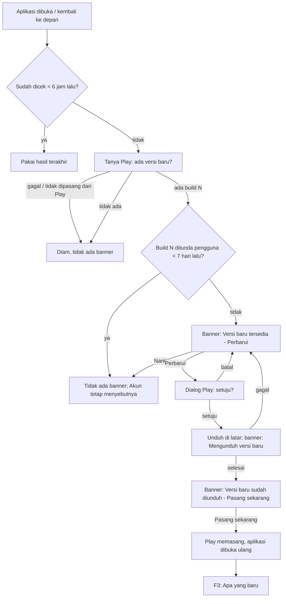

# Pengumuman pembaruan: versi baru dari Play Store dan pembaruan kecil Shorebird

**Tanggal:** 11 Oktober 2026.
**Status:** Draf, menunggu keputusan pemilik (§12). Keputusan arsitekturnya
di [ADR-039](../../02-architecture/adr/0039-pengumuman-pembaruan-aplikasi.md)
(Proposed); tugasnya Fase 20 di TASK_LIST.
**Berkaitan:** [ADR-023](../../02-architecture/adr/0023-identitas-opsional-firebase-auth-analitik-crashlytics.md)
(Analytics/Crashlytics), T-8.7 (rilis Android dan Shorebird),
[PLAY_DATA_SAFETY.md](../../03-release/PLAY_DATA_SAFETY.md), skill
`release-email` (catatan rilis untuk penguji).

Dokumen ini merancang perilaku, alur, aturan, dan teks. Rupa visual
mengikuti komponen yang sudah ada (banner perhatian, baris setelan, lembar);
yang belum ada ditandai "perlu rupa dari ui-ux-designer".

## 1. Ringkasan keputusan (usulan)

1. **Dua mekanisme, satu bahasa untuk pengguna.** Pengguna tidak perlu tahu
   Play Store atau Shorebird. Rilis toko disebut **versi baru**, tambalan
   Shorebird disebut **pembaruan kecil**. Keduanya diumumkan di tempat yang
   sama: banner di Beranda dan baris **Versi aplikasi** di Akun.
2. **Versi baru dari Play Store memakai In-App Updates mode fleksibel.**
   Pengguna mengetuk **Perbarui**, unduhan berjalan di latar sementara
   aplikasi tetap dipakai, lalu **Pasang sekarang** memasang dan membuka
   ulang aplikasi. Tidak ada pembaruan paksa di R1 (KT-U1).
3. **Pembaruan kecil tetap diunduh otomatis oleh Shorebird** (setelan
   `auto_update` sekarang tidak diubah). Aplikasi hanya membaca keadaannya:
   bila tambalan sudah terunduh dan menunggu dibuka ulang, Beranda memberi
   tahu sekali (KT-U2).
4. **"Apa yang baru" tampil sekali** sesudah versi atau pembaruan kecil yang
   punya catatan terpasang, lalu bisa dibuka lagi dari Akun (KT-U3).
   Catatannya ditulis di dalam kode aplikasi (teks i18n), bukan diambil dari
   server, sehingga ikut terbawa oleh tambalan Shorebird dan terbaca tanpa
   koneksi.
5. **Tidak pernah mengganggu pencatatan.** Pengumuman hanya di Beranda dan
   Akun, tidak pernah di tengah Catat, suara, atau lembar lain; tidak muncul
   selama onboarding atau tur; kalah prioritas dari banner kotak masuk
   notifikasi; dan diam saja saat luring atau saat pengecekan gagal.
6. **Tanpa server baru dan tanpa data keuangan keluar perangkat.** Yang
   bertambah hanya pertanyaan "ada versi baru?" ke aplikasi Play Store di
   perangkat dan pembacaan keadaan Shorebird yang sudah berjalan sejak T-8.7.
   Keduanya tetap perlu dicek terhadap formulir Keamanan Data (§9).

## 2. Masalah dan bukti

- **Penguji closed testing tidak tahu ada versi baru.** Play Store
  memperbarui aplikasi di latar hanya bila pembaruan otomatis menyala dan
  ponsel memenuhi syaratnya (Wi-Fi, mengisi daya, aplikasi tidak sedang
  dipakai). Banyak penguji tetap di versi lama berhari-hari, sehingga
  laporan mereka sering tentang bug yang sudah diperbaiki. Bukti: permintaan
  pemilik 11 Okt 2026; email rilis (skill `release-email`) sejauh ini
  satu-satunya cara memberi tahu, dan email tidak dibaca saat aplikasi
  dibuka. *Asumsi* sampai diukur: belum ada data berapa persen penguji di
  versi terbaru (lihat §3, ukuran keberhasilan).
- **Tambalan Shorebird tidak terlihat sama sekali.** Shorebird mengunduh
  tambalan di latar saat aplikasi dibuka, dan tambalan baru dipakai pada
  pembukaan **berikutnya**. Pengguna yang jarang menutup aplikasi bisa lama
  memakai kode lama tanpa tahu, dan tidak pernah tahu apa yang berubah.
- **Pemilik dan penguji tidak bisa melihat versi persis yang terpasang.**
  Layar Akun belum menampilkan nomor versi, apalagi nomor tambalan, sehingga
  laporan bug tidak bisa dicocokkan dengan kode.

## 3. Tujuan, non-tujuan, dan ukuran keberhasilan

**Tujuan**

1. Pengguna tahu ada versi baru dan bisa memasangnya tanpa keluar ke Play
   Store, dalam dua ketukan dari Beranda.
2. Pengguna tahu pembaruan kecil sudah siap dan cara memakainya (tutup lalu
   buka lagi aplikasi).
3. Pengguna tahu apa yang berubah, dalam bahasa manfaat, sekali saja.
4. Pemilik dan penguji bisa membaca versi dan nomor pembaruan kecil yang
   terpasang di Akun, dan nomor itu ikut terkirim ke Analytics dan
   Crashlytics.

**Non-tujuan (R1)**

- Pembaruan paksa atau "versi minimum" (butuh konfigurasi jarak jauh,
  B-39).
- iOS: aplikasi belum dirilis di App Store; App Store tidak punya API
  pembaruan di dalam aplikasi. Pembaruan kecil Shorebird di iOS ikut berlaku
  begitu iOS dirilis karena alurnya sama (B-39).
- Mengatur jalur Shorebird (stable/beta/staging) dari aplikasi, prioritas
  pembaruan Play (`updatePriority`), atau catatan rilis yang diambil dari
  server.
- Mengubah setelan `auto_update` Shorebird atau memberi pengguna pilihan
  "jangan unduh pembaruan kecil".
- Tombol "buka ulang sekarang" untuk pembaruan kecil (KT-U2).

**Ukuran keberhasilan**

| Ukuran | Target | Cara mengukur |
|---|---|---|
| Pengguna aktif di versi toko terbaru | ≥80% dalam 7 hari sesudah dipublikasikan | Dimensi bawaan `app_version` Analytics |
| Pengguna aktif di pembaruan kecil terbaru | ≥80% dalam 3 hari sesudah tambalan dirilis | Properti pengguna `patch_number` (baru, §8) |
| Banner versi baru berujung dipasang | ≥50% dari `update_banner_shown{kind: store}` | `update_banner_action{action: install}` / `shown` |
| Laporan bug penguji yang menyebut versi | Setiap laporan bisa dicocokkan ke versi + tambalan | Crashlytics custom key `patch_number`, baris Versi aplikasi di Akun |

## 4. Pengguna dan skenario

Angka versi memakai skema sekarang: `0.5.0+6` = nama versi `0.5.0`, nomor
build (versionCode Play) `6`.

**S1 — Versi baru di Play Store.** Rani penguji closed testing, terpasang
`0.5.0+6` tanpa tambalan. Pemilik mempublikasikan `0.6.0+7` di jalur closed
testing. Senin pagi Rani membuka aplikasi untuk mencatat kopi Rp25.000.
Beranda menampilkan banner "Versi baru tersedia. [Perbarui]". Rani
mengabaikannya dan mencatat kopi lewat Catat seperti biasa (banner tidak
mengganggu). Siang hari ia mengetuk **Perbarui**, Play menampilkan dialognya
sendiri, Rani setuju, unduhan berjalan di latar. Beberapa menit kemudian
banner berganti "Versi baru sudah diunduh. [Pasang sekarang]". Rani
mengetuk, aplikasi tertutup sebentar dan terbuka lagi di `0.6.0+7`, lalu
lembar **Apa yang baru di versi 0.6.0** tampil sekali. Saldo dan transaksi
kopi Rp25.000 tetap ada.

**S2 — Pembaruan kecil Shorebird.** Budi terpasang `0.6.0+7` tambalan 0.
Pemilik merilis tambalan 1 (perbaikan perhitungan sisa anggaran). Saat Budi
membuka aplikasi, Shorebird mengunduh tambalan 1 di latar. Begitu selesai,
Beranda menampilkan "Pembaruan kecil siap. Tutup lalu buka lagi aplikasi
untuk memakainya. [Oke]". Budi mengetuk **Oke**, banner hilang dan tidak
muncul lagi untuk tambalan 1. Malamnya Budi menutup aplikasi dari daftar
aplikasi terakhir dan membukanya lagi; kini berjalan tambalan 1, dan lembar
**Apa yang baru** menampilkan "Sisa anggaran kini dihitung benar saat
transaksi dipindah ke pos lain."

**S3 — Pembaruan kecil tanpa catatan.** Tambalan 2 hanya memperbaiki galat
yang tidak terasa pengguna; pemilik tidak menulis catatan. Banner "Pembaruan
kecil siap" tetap tampil sekali (tidak bisa tahu isinya sebelum terpasang,
§6 B-9), tetapi sesudah dibuka ulang tidak ada lembar Apa yang baru.

**S4 — Keduanya ada.** Citra di `0.5.0+6` tambalan 1, tambalan 2 sudah
terunduh, dan `0.6.0+7` juga tersedia di Play. Beranda hanya menampilkan
banner **versi baru** (versi toko sudah memuat semua perbaikan; tambalan
untuk build lama tidak berguna lagi sesudah versi baru terpasang).

**S5 — Luring.** Dodi di pesawat, membuka aplikasi untuk mencatat makan
Rp58.000. Pengecekan gagal diam-diam; tidak ada banner, tidak ada pesan
galat. Akun menampilkan versi yang terpasang saja.

## 5. Alur pengguna

### F1. Versi baru dari Play Store (Android)

1. Titik masuk: Beranda (banner) atau Akun → Versi aplikasi.
2. Ketukan: **Perbarui** (1) → setuju di dialog Play (2) → **Pasang
   sekarang** (3) sesudah unduhan selesai. Dua ketukan di aplikasi, satu di
   dialog Play.
3. Banner punya tombol tutup **Nanti** pada keadaan "tersedia". Pada keadaan
   "mengunduh" tidak ada tindakan; pada "sudah diunduh" tidak bisa ditunda
   (unduhan sudah terjadi, memasangnya tinggal satu ketuk) tetapi tidak
   memaksa.
4. Jalan pulang: batal di dialog Play → kembali ke "tersedia"; unduhan gagal
   → kembali ke "tersedia" tanpa pesan galat panjang; aplikasi ditutup saat
   mengunduh → saat dibuka lagi, keadaan dibaca ulang dari Play (bisa
   "mengunduh" atau "sudah diunduh").
5. Tidak dipasang dari Play (build debug, APK langsung, emulator tanpa
   Play) → diam; Akun hanya menampilkan versi.

### F2. Pembaruan kecil Shorebird

1. Saat aplikasi dibuka, Shorebird mengunduh tambalan di latar (perilaku
   sekarang).
2. Saat dibuka dan saat kembali ke depan, aplikasi membaca keadaan
   Shorebird. Bila ada tambalan berikutnya yang sudah terunduh (nomor
   tambalan berikutnya > nomor yang sedang berjalan) dan nomor itu belum
   pernah diumumkan → banner "Pembaruan kecil siap. Tutup lalu buka lagi
   aplikasi untuk memakainya. [Oke]".
3. **Oke** atau menutup banner → nomor tambalan itu tercatat sudah
   diumumkan; banner tidak muncul lagi untuk nomor itu. Akun tetap
   menyebut "Pembaruan kecil siap, buka ulang aplikasi".
4. Pengguna menutup dan membuka lagi aplikasi → tambalan berjalan → F3.
5. Build tanpa Shorebird (debug, `flutter run`) → diam.

### F3. Apa yang baru

1. Saat aplikasi dibuka, bandingkan **versi terakhir yang dilihat**
   (build, tambalan) dengan versi yang berjalan.
2. Pemasangan pertama (belum ada versi terakhir) → simpan versi sekarang
   tanpa menampilkan apa-apa; pengguna baru melihat onboarding, bukan
   catatan perubahan.
3. Versi berjalan lebih baru → kumpulkan catatan untuk semua (build,
   tambalan) yang lebih baru dari versi terakhir dan paling baru dari versi
   berjalan. Ada catatan → lembar **Apa yang baru** di Beranda, sekali.
   Tidak ada → tidak tampil apa-apa. Dalam dua kasus itu versi terakhir
   diperbarui ke versi berjalan.
4. Lembar menunggu bila onboarding atau tur spotlight sedang berjalan, dan
   tampil pada pembukaan Beranda berikutnya.
5. Akun → **Versi aplikasi** → membuka daftar semua catatan (terbaru di
   atas), kapan saja.

### F4. Versi aplikasi di Akun

Baris **Versi aplikasi** di grup paling bawah layar Akun:

- Nilai: "0.6.0 (7)" atau, bila tambalan berjalan, "0.6.0 (7), pembaruan 1"
  (KT-U4).
- Keterangan keadaan di bawahnya, satu dari: **Terbaru** (tidak ada apa-apa
  dan pengecekan Play berhasil), **Versi baru tersedia**, **Mengunduh versi
  baru**, **Versi baru sudah diunduh**, **Pembaruan kecil siap, buka ulang
  aplikasi**, atau kosong (tidak bisa dicek: luring, bukan dari Play).
- Ketuk baris → layar/lembar **Apa yang baru** (daftar catatan) dengan
  tombol sesuai keadaan di atasnya (**Perbarui** / **Pasang sekarang**),
  sehingga pengguna yang sudah menekan **Nanti** tetap punya jalan.
- Membuka Akun memicu pengecekan Play bila hasil terakhir lebih tua dari
  6 jam.

## 6. Aturan bisnis

| # | Aturan (bisa diuji) |
|---|---|
| B-1 | Pengumuman pembaruan tidak pernah menulis atau membaca data keuangan; saldo, transaksi, anggaran, dan rutin sama persis sebelum dan sesudah memasang versi baru atau pembaruan kecil. |
| B-2 | Banner pembaruan hanya tampil di Beranda, di slot `notice` yang sama dengan banner kotak masuk notifikasi. Bila kotak masuk punya transaksi menunggu, banner kotak masuk yang tampil (satu banner per layar, `writing.md`). |
| B-3 | Prioritas di slot itu: kotak masuk notifikasi > versi baru sudah diunduh > versi baru tersedia/mengunduh > pembaruan kecil siap. |
| B-4 | Versi baru dari Play mengalahkan pembaruan kecil: bila keduanya ada, hanya versi baru yang diumumkan (S4). |
| B-5 | Pengecekan Play paling sering sekali per 6 jam (saat dibuka, kembali ke depan, atau membuka Akun). Kegagalan apa pun = "tidak diketahui", tanpa banner dan tanpa pesan galat. |
| B-6 | **Nanti** menunda banner untuk build itu selama 7 hari. Build yang lebih baru dari yang ditunda tampil lagi tanpa menunggu. |
| B-7 | **Pasang sekarang** hanya dijalankan dari ketukan pengguna di Beranda atau Akun. Aplikasi tidak pernah memanggil pemasangan sendiri. |
| B-8 | Banner pembaruan kecil tampil paling banyak sekali per nomor tambalan. |
| B-9 | Isi pembaruan kecil yang belum berjalan tidak bisa dibaca (kodenya belum dimuat), jadi banner pembaruan kecil tidak pernah menyebut isinya; isinya baru tampil lewat Apa yang baru sesudah dibuka ulang. |
| B-10 | Apa yang baru tampil otomatis paling banyak sekali per (build, tambalan), tidak pada pemasangan pertama, dan tidak selama onboarding atau tur. |
| B-11 | Catatan Apa yang baru ditulis di teks i18n (id dan en) per (build, tambalan), paling banyak tiga butir, masing-masing satu kalimat manfaat. Hanya perubahan yang terasa pengguna. Tidak ada catatan = tidak ada lembar. |
| B-12 | Lompat beberapa versi (mis. `0.5.0+6` → `0.7.0+9`): lembar menggabungkan catatan semua versi di antaranya, terbaru di atas, paling banyak enam butir; sisanya di Akun. |
| B-13 | Inti aplikasi tetap luring: tidak ada alur pencatatan yang menunggu hasil pengecekan pembaruan. Pengecekan berjalan sesudah Beranda tampil, tidak menunda pembukaan. |

Penyimpanan lokal (preferensi, bukan entitas domain; DOMAIN_MODEL tidak
berubah): versi terakhir yang dilihat (build, tambalan), build yang ditunda
dan waktunya, nomor tambalan terakhir yang diumumkan, waktu pengecekan Play
terakhir. Semua milik perangkat, ikut terhapus bila data aplikasi dihapus.

## 7. Kebutuhan informasi per layar

**Banner Beranda** (pola "Banner perhatian" yang sudah ada, satu kalimat +
satu aksi; tidak butuh rupa baru):

| Keadaan | Teks | Aksi | Bisa ditutup |
|---|---|---|---|
| Versi baru tersedia | Versi baru tersedia. | Perbarui | Ya (Nanti) |
| Mengunduh | Mengunduh versi baru. Kamu tetap bisa mencatat. | — | Tidak |
| Sudah diunduh | Versi baru sudah diunduh. | Pasang sekarang | Tidak |
| Pembaruan kecil siap | Pembaruan kecil siap. Tutup lalu buka lagi aplikasi untuk memakainya. | Oke | Ya (Oke) |

**Lembar Apa yang baru** (perlu rupa dari ui-ux-designer: lembar bawah
sederhana; belum ada di prototipe):

1. Judul: "Apa yang baru di versi 0.6.0" (pembaruan kecil: "Apa yang baru").
2. Daftar 1–3 butir (sampai enam bila menggabungkan, B-12), urut sesuai
   tulisan.
3. Satu tombol: **Oke**. Menutup lembar = sudah dilihat.

**Akun → Versi aplikasi** (pola baris setelan yang sudah ada; daftar
catatannya memakai rupa lembar di atas atau halaman sederhana, keputusan
ui-ux-designer):

1. Versi dan pembaruan kecil yang berjalan (F4).
2. Keterangan keadaan (F4).
3. Tindakan sesuai keadaan: Perbarui / Pasang sekarang.
4. Daftar catatan Apa yang baru semua versi, terbaru di atas. Kosong: "Belum
   ada catatan pembaruan."

## 8. Analitik dan diagnostik

Peristiwa lewat `AppAnalytics` (kelas baru `UpdateEvents`), tanpa data
pribadi atau keuangan:

| Peristiwa | Parameter | Kapan |
|---|---|---|
| `update_banner_shown` | `kind: store\|patch`, `stage: available\|downloading\|downloaded\|ready` | Banner tampil (sekali per keadaan per sesi) |
| `update_banner_action` | `kind`, `action: update\|install\|dismiss`, `source: home\|account` | Ketukan Perbarui / Pasang sekarang / Nanti / Oke |
| `app_updated` | `kind: store\|patch`, `from_build`, `to_build`, `to_patch` | Pembukaan pertama sesudah versi berubah (bukan pemasangan pertama) |
| `whats_new_viewed` | `build`, `patch`, `source: auto\|account` | Lembar Apa yang baru dibuka |

Tambahan: properti pengguna Analytics `patch_number` dan custom key
Crashlytics `patch_number` (0 bila tanpa tambalan), dipasang saat aplikasi
dibuka, supaya ukuran keberhasilan dan laporan galat bisa dipilah per
tambalan.

## 9. Privasi dan Keamanan Data

- **Play In-App Updates** bertanya ke aplikasi Play Store di perangkat
  lewat pustaka Play; aplikasi kita tidak mengirim apa pun ke server kita.
  Panduan Keamanan Data Google untuk pustaka Play perlu dibaca ulang sebelum
  formulir diisi (T-20.7).
- **Shorebird sudah menghubungi servernya sejak T-8.7** (`auto_update`
  bawaan menyala) untuk menanyakan tambalan, tetapi
  [PLAY_DATA_SAFETY.md](../../03-release/PLAY_DATA_SAFETY.md) belum
  menyebutnya. Fitur ini tidak menambah panggilan Shorebird, tetapi celah
  pencatatannya ditutup di T-20.7: data apa yang dikirim Shorebird
  (menurut dokumentasi resminya) dan apakah perlu dideklarasikan.
- `patch_number` sebagai properti pengguna dan custom key menambah satu
  atribut ke data Analytics/Crashlytics yang sudah dideklarasikan; bukan
  jenis data baru.
- Tidak ada data keuangan, teks transaksi, atau identitas yang keluar
  perangkat karena fitur ini.

## 10. Kata dan kalimat (id / en)

Kunci yang diusulkan; engineer boleh merapikan sesuai struktur i18n.

| Kunci | id | en |
|---|---|---|
| `appUpdate.banner.storeAvailable` | Versi baru tersedia. | A new version is available. |
| `appUpdate.banner.storeDownloading` | Mengunduh versi baru. Kamu tetap bisa mencatat. | Downloading the new version. You can keep recording. |
| `appUpdate.banner.storeDownloaded` | Versi baru sudah diunduh. | The new version is downloaded. |
| `appUpdate.banner.patchReady` | Pembaruan kecil siap. Tutup lalu buka lagi aplikasi untuk memakainya. | A small update is ready. Close and reopen the app to use it. |
| `appUpdate.action.update` | Perbarui | Update |
| `appUpdate.action.install` | Pasang sekarang | Install now |
| `appUpdate.action.later` | Nanti | Later |
| `appUpdate.action.ok` | Oke | OK |
| `appUpdate.whatsNew.title` | Apa yang baru di versi {version} | What's new in version {version} |
| `appUpdate.whatsNew.titlePatch` | Apa yang baru | What's new |
| `appUpdate.whatsNew.empty` | Belum ada catatan pembaruan. | No update notes yet. |
| `account.version.label` | Versi aplikasi | App version |
| `account.version.value` | {version} ({build}) | {version} ({build}) |
| `account.version.valuePatched` | {version} ({build}), pembaruan {patch} | {version} ({build}), patch {patch} |
| `account.version.statusLatest` | Terbaru | Up to date |
| `account.version.statusAvailable` | Versi baru tersedia | New version available |
| `account.version.statusDownloading` | Mengunduh versi baru | Downloading new version |
| `account.version.statusDownloaded` | Versi baru sudah diunduh | New version downloaded |
| `account.version.statusPatchReady` | Pembaruan kecil siap, buka ulang aplikasi | Small update ready, reopen the app |

Catatan Apa yang baru per versi ditulis dengan gaya yang sama: kalimat
manfaat, "kamu", tanpa tanda seru, tanpa istilah teknis ("tambalan",
"patch", "bug" tidak dipakai di id). Contoh: "Sisa anggaran kini dihitung
benar saat transaksi dipindah ke pos lain."

Istilah baru masuk glosarium: **Versi baru**, **Pembaruan kecil**, **Apa
yang baru**.

## 11. Kasus tepi

| Kasus | Perilaku |
|---|---|
| Pengguna sedang di Catat saat unduhan versi baru selesai | Tidak ada apa pun di Catat; banner "sudah diunduh" menunggu di Beranda (B-2, B-7). |
| Aplikasi dipindah ke latar sesudah unduhan selesai, tanpa Pasang sekarang | Saat kembali, banner "sudah diunduh" tampil lagi. Engineer memverifikasi apakah Play memasang sendiri saat aplikasi di latar; bila ya, pembukaan berikutnya langsung ke F3. |
| Pemasangan versi baru saat notifikasi sedang diproses (ADR-032) | Antrean notifikasi hanya di-ack sesudah tersimpan, jadi pemasangan tidak menghilangkan transaksi; diverifikasi di T-20.8. |
| Penguji keluar dari program closed testing | Play tidak menawarkan build tes; tidak ada banner. |
| Tambalan Shorebird ditarik (rollback) | Nomor tambalan berjalan bisa turun; versi terakhir yang dilihat tidak diturunkan, tidak ada lembar, tidak ada galat. |
| Versi baru terpasang sementara tambalan build lama masih "siap" | Tambalan build lama tidak berlaku lagi; nomor tambalan yang diumumkan diatur ulang per build. |
| Bahasa aplikasi diganti sesudah lembar tampil | Akun menampilkan catatan dalam bahasa baru; lembar tidak tampil ulang. |
| Penyimpanan preferensi gagal dibaca | Anggap pemasangan pertama: tidak menampilkan lembar (lebih baik terlewat daripada tampil berulang). |
| Pengguna menghapus data aplikasi | Sama dengan pemasangan pertama. |
| Mode tampil gelap / sembunyikan nominal | Tidak berpengaruh; tidak ada nominal di fitur ini. |

## 12. Pertanyaan untuk pemilik

- **KT-U1 — Mode pembaruan Play.** Rekomendasi: **fleksibel saja** di R1
  (unduh di latar, pasang saat pengguna mengetuk). Mode langsung (layar
  penuh, wajib) baru masuk akal dengan "versi minimum" dari konfigurasi
  jarak jauh untuk perbaikan kritis data, dicatat di B-39.
- **KT-U2 — Pembaruan kecil diumumkan atau diam.** Rekomendasi: **umumkan
  sekali per tambalan** dengan banner "Pembaruan kecil siap" yang bisa
  ditutup, tanpa tombol buka ulang. Alasannya: pemilik ingin pengguna tahu,
  dan tambalan sering berisi perbaikan angka yang penting cepat dipakai.
  Tombol "buka ulang sekarang" ditolak karena Android tidak menyediakan
  cara resmi memulai ulang proses aplikasi; pustaka pihak ketiga untuk itu
  rawan dan bisa memotong proses notifikasi yang sedang berjalan.
- **KT-U3 — Apa yang baru otomatis.** Rekomendasi: **tampil sekali
  otomatis** di Beranda bila ada catatan, plus selalu tersedia di Akun.
  Alternatifnya hanya di Akun, tetapi hampir tidak ada yang membukanya.
- **KT-U4 — Format versi di Akun.** Rekomendasi: "0.6.0 (7), pembaruan 1".
  Nomor build dan tambalan dibutuhkan untuk laporan bug penguji; kata
  "pembaruan" lebih ramah daripada "patch".
- **KT-U5 — Siapa menulis catatan Apa yang baru.** Rekomendasi: agen
  menyusun draf dari TASK_LIST/commit saat menyiapkan rilis atau tambalan
  (bersama email rilis), pemilik menyetujui sebelum `shorebird release`
  atau `shorebird patch`.

## 13. Fase rilis

- **R1 (Fase 20):** semua di atas untuk Android.
- **R2 (B-39):** versi minimum/pembaruan paksa lewat konfigurasi jarak jauh,
  iOS (App Store), dan jalur Shorebird untuk penguji.
