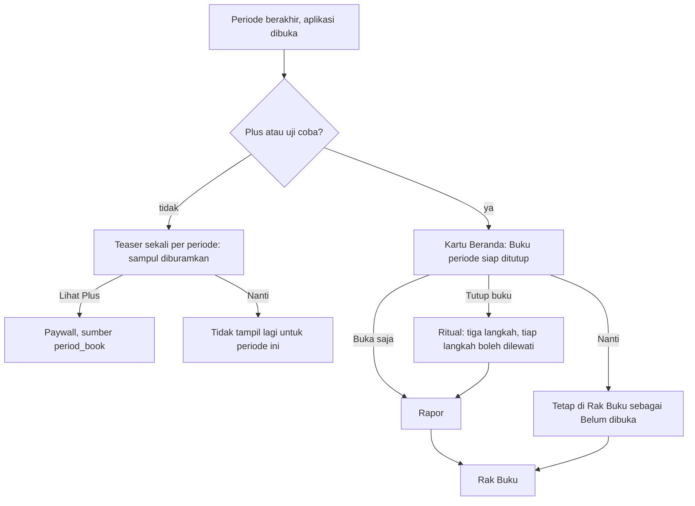

# Buku Periode: satu periode, satu buku, ditutup dan diceritakan Tanuki

**Tanggal:** 12 November 2026.
**Status:** Draf, menunggu keputusan pemilik (§16). Keputusan pemilik 12 Nov
2026: **seluruh Buku Periode hanya untuk Plus.** Belum dijadwalkan ke fase
(antrean B-95; menggeser B-49).
**Berkaitan:** [FREEMIUM_PAYWALL.md](FREEMIUM_PAYWALL.md) §6.5, §16, §16.4
(revisi pembagian gratis dan Plus), [GAMIFICATION.md](GAMIFICATION.md)
(mesin tonggak B-94, stempel), [FINANCIAL_PERIOD.md](FINANCIAL_PERIOD.md)
(periode keuangan), [FINANCIAL_ANALYSIS.md](FINANCIAL_ANALYSIS.md) (Analisis
dan kilas balik), [APP_UPDATE.md](APP_UPDATE.md) (pola banner dan lembar yang
menunggu), [ADR-041](../../02-architecture/adr/0041-monetisasi-hak-plus-dan-uji-coba.md)
(hak Plus).

Dokumen ini merancang perilaku, aturan, dan teks. Cara teknisnya diputuskan
engineer (§13). Rupa visual belum ada dan ditandai "perlu rupa dari
ui-ux-designer".

## 1. Ringkasan keputusan (usulan)

1. **Satu periode keuangan = satu buku.** Saat periode berakhir, bukunya
   siap: ajakan **Tutup buku** (ritual dua menit yang boleh dilewati),
   lalu **rapor** yang diceritakan Tanuki, lalu tersimpan di **Rak Buku**.
   Ini menyatukan tiga ide: tutup buku periode, Tanuki yang bereaksi, dan
   rapor bulanan bercerita (B-49).
2. **Seluruhnya Plus** (keputusan pemilik 12 Nov 2026): ritual, rapor,
   Tanuki sebagai narator, dan Rak Buku. Pengguna Gratis hanya melihat satu
   **teaser** per periode (BP-2). Akibatnya ke keputusan sebelumnya ada di
   §2.
3. **Yang sudah gratis tetap gratis:** kartu Arus Beranda, Analisis 6 periode,
   dan kilas balik di kartu tinjau awal bulan sudah dikirim dan tidak
   ditarik (KT-BP3).
4. **Tutup buku tidak mengunci data.** Ritual hanya merapikan dan
   merayakan; transaksi periode lampau tetap bisa disunting (BP-5).
5. **Angka selalu dihitung langsung** dari data, sama persis dengan Beranda,
   Analisis, dan Rencana (BP-4). Stempel yang tercetak di sampul permanen.
6. **Tanuki bercerita, tidak menilai.** Kalimat dari templat lokal, tanpa
   mengirim data, tanpa kata yang menghakimi belanja (BP-7, BP-8).
7. **Satuannya buku, jadi mudah tumbuh:** halaman baru (Target, Penjaga,
   Freelance), Rapor Tahunan (satu rak berisi 12 buku), Kamar Tanuki, dan
   bagikan menambah halaman atau lapisan, bukan mengubah yang lama (§11).

## 2. Akibat ke keputusan sebelumnya

"Full Plus" mengubah pembagian di FREEMIUM_PAYWALL. Yang berubah, dan yang
tidak, supaya tidak ada dokumen yang saling bertentangan:

| Yang sebelumnya | Sekarang |
|---|---|
| §6.5: "Versi gratis: kartu angka ringkas" untuk rapor | **Dihapus.** Gratis tidak punya rapor; hanya teaser (BP-2) |
| §5 baris ⑤: Gratis "Rapor bulanan ringkas (angka, bisa dibagikan)" | Gratis: teaser sampul yang diburamkan. Arus, Analisis 6 periode, dan kilas balik tetap gratis |
| §9 P6: "rapor ringkas tampil, rapor bercerita diburamkan" | Teaser menggantikannya: satu kartu, sampul diburamkan dengan data asli |
| §8.2 uji coba: "Rapor bulanan bercerita untuk periode uji coba" sebagai momen Plus terakhir | Tetap, kini berupa **Buku Periode** uji coba (lebih kuat: pengalaman penuh) |
| §16.2: gamifikasi terutama alat retensi versi gratis | Stempel B-94 **tetap gratis** (KT-BP1); bagi pengguna Plus, stempel periode ikut tercetak di sampul buku |
| B-49 "Plus; gratis: rapor ringkas" | B-49 menjadi lapisan R2 di atas B-95 (tipe tanuki, bagikan, PDF/Excel); tidak ada versi gratis |
| §10: "Rapor yang sudah dibuat tetap bisa dibuka dan dibagikan" sesudah Plus berakhir | **Tetap berlaku** (BP-10) |

Konsekuensi yang perlu disadari pemilik:

- **Saluran pertumbuhan lewat rapor gratis hilang.** Rapor ringkas yang bisa
  dibagikan tadinya membawa nama aplikasi ke luar; sekarang hanya pengguna
  Plus yang bisa membagikan (R2).
- **Pengguna Gratis kehilangan alasan kembali di akhir periode,** kecuali
  stempel (B-94) dan kilas balik yang sudah ada. Teaser menjadi satu-satunya
  permukaan konversi dari buku, sehingga nadanya harus tenang (BP-2).
- **Teaser pertama baru muncul sesudah ada periode yang berakhir.** Pengguna
  baru tidak melihatnya di bulan pertama.

## 3. Masalah dan bukti

- **Tidak ada momen penutup.** Periode keuangan berganti diam-diam. Pengguna
  tidak merasakan "satu bulan selesai" dan tidak diajak merapikan transaksi
  tanpa kategori atau rutin yang menunggu padahal Analisis akan lebih tepat.
  Bukti: temuan FR-ANL-005 (Tanpa kategori), keputusan kilas balik di tinjau
  awal bulan, dan riset gamifikasi di laporan bisnis pemilik (FREEMIUM_PAYWALL
  §16). *Asumsi sampai diukur:* belum ada data berapa persen pengguna
  merapikan periode lama.
- **Plus belum punya pengalaman penutup yang berkesan.** Pilar ⑤ Tanuki
  Melapor belum ada; uji coba Plus berakhir tanpa momen puncak.
- **Pesaing memberi laporan bulanan datar** (tabel dan grafik). Ruang yang
  kosong: cerita pendek yang hangat tanpa menghakimi.

## 4. Tujuan, non-tujuan, dan ukuran keberhasilan

**Tujuan**

1. Memberi rasa selesai di akhir tiap periode dan mendorong catatan yang
   lebih rapi tanpa menekan.
2. Membuat uji coba dan langganan Plus punya momen yang berkesan di tiap
   gajian.
3. Menyediakan satu satuan (buku) yang menampung rapor tahunan, halaman
   fitur baru, dan kosmetik.

**Non-tujuan (R1)**

- Tipe tanuki, bagikan, PDF/Excel (R2), Rapor Tahunan dan Kamar Tanuki (R3).
- Rapor oleh AI generatif (R1 memakai templat lokal).
- Menilai belanja, memberi skor, atau membandingkan dengan pengguna lain.
- Mengunci periode atau menghalangi suntingan.
- Notifikasi dorong. Semuanya hanya tampil saat aplikasi dibuka.
- Dokumen resmi. Rapor adalah rekap catatan pribadi, bukan pengganti rekening
  koran atau laporan pajak.

**Ukuran keberhasilan** (ambang adalah usulan sampai ada garis dasar)

| Ukuran | Usulan | Cara mengukur |
|---|---|---|
| Pengguna Plus yang membuka buku periode terakhir dalam 7 hari sesudah periode berakhir | ≥50% | `book_opened{plus: true}` |
| Transaksi tanpa kategori turun sesudah ritual | Pengguna yang menyelesaikan langkah itu tidak meninggalkan transaksi tanpa kategori | `book_ritual_step{step: uncategorized, done: true}` |
| Teaser mengantar ke Plus | Konversi teaser → pembelian lebih tinggi daripada P1–P5 yang berbasis batas | `paywall_opened{source: period_book}` → pembelian |
| Teaser tidak mengganggu | <10% menutup dengan "Jangan tampilkan lagi" atau mengeluh | `book_teaser_dismissed{forever}` dan umpan balik penguji |
| Uji coba berakhir dengan buku dibuka | ≥60% pengguna uji coba membuka bukunya | `book_opened{source: trial}` |

## 5. Pengguna dan skenario

Semua nominal dalam rupiah; periode 25 Okt – 24 Nov 2026. Rani mencatat 12
transaksi: pemasukan gaji Rp8.500.000 dan 11 pengeluaran (kos Rp1.200.000,
internet Rp350.000, makan Rp1.640.000, transport Rp520.000, belanja
Rp780.000, hiburan Rp215.000) dengan total pengeluaran **Rp4.705.000** dan
selisih **Rp3.795.000**. Makan 35%, kos 26%, belanja 17% dari pengeluaran
(persen dibulatkan setengah ke atas, jumlah tidak dipaksa 100%). Tiga
rutin periode itu: kos dan internet dicatat, cicilan Rp2.914.000 dilewati
karena sudah lunas.

**S1 — Rani (Plus), ritual lengkap.** Pada 25 Nov Rani membuka aplikasi.
Kartu di Beranda: "Buku 25 Okt – 24 Nov siap ditutup". Ia mengetuk **Tutup
buku**. Langkah 1: "Semua transaksi sudah berkategori." Langkah 2: "Semua
rutin sudah selesai." Langkah 3: kilas balik rencana dan kenyataan. Ia
mengetuk **Tutup buku**. Tanuki muncul bersama dua stempel periode (Periode
rapi, Rutin tak terlewat), lalu rapor: Arus (pemasukan Rp8.500.000,
pengeluaran Rp4.705.000, selisih Rp3.795.000), Ke mana uang pergi, dan
beberapa kalimat dari Tanuki. Bukunya masuk Rak Buku.

**S2 — Budi (Plus), ada yang tertinggal.** Budi punya 14 transaksi, 2 belum
berkategori. Langkah 1 menampilkan "2 transaksi belum berkategori" dengan
**Beri kategori** (membuka Riwayat tersaring) dan **Lewati**. Ia melewatinya.
Rapor tetap terbuka, dengan satu catatan netral "2 transaksi belum
berkategori, jadi pembagian kategori belum penuh" dan tautan Beri kategori.
Ia memberi kategori seminggu kemudian; angka rapor ikut berubah (BP-4) dan
stempel Periode rapi diraih pada pembukaan berikutnya (GAMIFICATION S5).

**S3 — Dodi (Gratis), teaser.** Pada 25 Nov Dodi melihat satu kartu di
Beranda: "Buku 25 Okt – 24 Nov sudah siap. Buka ceritanya dengan Plus."
dengan sampul yang diburamkan (data asli). Ia menutupnya. Kartu tidak muncul
lagi untuk periode itu. Arus, Analisis, dan kilas balik tetap seperti biasa.

**S4 — Uji coba berakhir.** Mira (Trial) mencapai hari pertama periode
berikutnya. Plus tetap aktif sampai buku periode uji coba dibuka atau paling
lama sehari sesudah periode berakhir. Bukunya dibuka sebagai momen Plus
terakhir; sesudah itu layar turun ke Gratis dengan penawaran 48 jam
(FREEMIUM_PAYWALL §8.2).

**S5 — Plus berakhir.** Tono membuka buku Oktober saat masih Plus.
Langganannya berakhir. Buku Oktober tetap bisa dibuka; buku November yang
belum pernah dibuka terkunci dan menampilkan teaser (BP-10).

**S6 — Periode peralihan.** Periode 25 Sep – 31 Okt (37 hari, peralihan)
mendapat buku berlabel "Periode peralihan · 37 hari". Tanpa halaman
"Dibanding biasanya" (peralihan tidak dibandingkan, FINANCIAL_ANALYSIS).

**S7 — Absen.** Sari tidak membuka aplikasi 70 hari. Ajakan Tutup buku
hanya untuk periode terakhir; dua periode sebelumnya masuk Rak Buku sebagai
"Belum dibuka", bisa dibuka kapan saja. Tidak ada hitungan "2 buku
menunggu" di Beranda.

## 6. Alur pengguna

1. **Titik masuk:** kartu Beranda di akhir periode, Rak Buku di Riwayat
   (segmen ketiga, KT-BP5), dan notifikasi tidak dipakai.
2. **Ritual (tiga langkah):**
   1. *Tanpa kategori:* jumlahnya dan **Beri kategori** (membuka Riwayat
      tersaring), atau "Semua transaksi sudah berkategori."
   2. *Rutin menunggu:* jumlahnya dan jalan ke segmen Rutin, atau "Semua
      rutin sudah selesai."
   3. *Kilas balik:* rencana dan kenyataan (kilas balik yang sudah ada).
   Penutup: tombol **Tutup buku** dan satu kalimat bahwa data tetap bisa
   diubah. Jumlah ketukan minimal: dua (Tutup buku di kartu, Tutup buku di
   akhir) bila semuanya sudah rapi.
3. **Rapor:** sampul lalu halaman (§7). Dapat digeser; menutup rapor
   kembali ke tempat asal.
4. **Jalan pulang:** menutup ritual di tengah menyimpan langkah yang sudah
   selesai; buku tetap "Siap ditutup" dan bisa dibuka dari Rak Buku.

## 7. Isi buku (kebutuhan informasi)

Halaman bersifat bersyarat: muncul hanya bila datanya ada. Urutan tetap.

| # | Halaman | Isi | Muncul bila |
|---|---|---|---|
| 0 | Sampul | Nama periode (P-11: nama bulan bila mulai tanggal 1, selain itu rentang; peralihan berlabel), Tanuki, stempel yang diraih di periode itu (B-94) | Selalu |
| 1 | Arus periode | Pemasukan, pengeluaran, selisih; transfer tidak dihitung; sama persis dengan Arus Beranda | Selalu |
| 2 | Ke mana uang pergi | Lima kategori pengeluaran teratas: nominal dan persen; Lainnya dan Tanpa kategori; pemasukan freelance tanpa kategori sebagai Freelance | Ada pengeluaran |
| 3 | Dibanding biasanya | Paling banyak tiga sorotan netral (selisih ≥20% dan ≥Rp50.000 terhadap rata-rata tiga periode) | Ada pembanding dan bukan peralihan |
| 4 | Rutin dan rencana | Rutin tercatat dan dilewati; rencana vs kenyataan (kilas balik) | Ada rutin atau anggaran |
| 5 | Kata Tanuki | Dua sampai empat kalimat dari templat lokal (§12) | Selalu |

Halaman 1–3 memakai aturan dan angka Analisis tanpa menghitung ulang.
Halaman baru (Target, Penjaga, Freelance, Utang) ditambahkan oleh fitur
masing-masing saat ada (§11).

## 8. Aturan bisnis

| # | Aturan (bisa diuji) |
|---|---|
| BP-1 | Ritual, rapor, Tanuki sebagai narator, dan Rak Buku hanya terbuka untuk Plus dan uji coba. Gratis hanya melihat teaser (BP-2) dan tidak pernah melihat isi buku. |
| BP-2 | Teaser: paling banyak **satu kartu per periode** di Beranda, sesudah periode berakhir, hanya bila periode itu punya ≥3 transaksi dan bukan periode pertama. Menutupnya = tidak muncul lagi untuk periode itu. Tidak tampil di Catat, lembar lain, onboarding, atau tur; kalah dari banner pembaruan; tidak ada hitung mundur atau pesan "kamu melewatkan". |
| BP-3 | Buku hanya untuk periode yang **sudah berakhir** dengan ≥1 transaksi. Periode berjalan tidak punya buku. Periode peralihan punya buku berlabel. |
| BP-4 | Semua angka di buku dihitung langsung dari data dengan aturan periode yang sama (`financialPeriodOf`, `periodDateOf`) dan sama persis dengan Arus Beranda, Analisis, dan Rencana (B-3, B-15). Tidak ada snapshot angka. Stempel di sampul permanen (GAMIFICATION G-1). |
| BP-5 | Tutup buku tidak mengunci, tidak mengubah saldo, anggaran, rutin, atau transaksi, dan tidak menghalangi suntingan periode lampau. |
| BP-6 | Setiap langkah ritual boleh dilewati; rapor bisa dibuka tanpa ritual. Meninggalkan langkah tidak menghukum; rapor hanya memberi catatan netral dengan jalan memperbaikinya. |
| BP-7 | Teks tidak pernah menilai belanja: tanpa "boros", "hemat", "terlalu", "kurang", skor, peringkat, atau perbandingan dengan pengguna lain. Sorotan memakai ambang Analisis (≥20% dan ≥Rp50.000, maksimal tiga). |
| BP-8 | Kalimat Tanuki berasal dari templat lokal dengan isian angka; tidak ada data keuangan keluar perangkat dan tidak memakai Gemini di R1. |
| BP-9 | Satu ajakan Tutup buku sekaligus, untuk periode terakhir. Periode lebih lama masuk Rak Buku sebagai "Belum dibuka" dan bisa dibuka kapan saja; tidak ada hitungan "n buku menunggu" di Beranda. |
| BP-10 | Sesudah Plus berakhir, buku yang **pernah dibuka** tetap bisa dibuka (dan dibagikan di R2); buku yang belum dibuka terkunci dan menampilkan teaser. Ini menepati "rapor yang sudah dibuat tetap bisa dibuka" (FREEMIUM_PAYWALL §10). |
| BP-11 | Uji coba: Plus tetap aktif sampai buku periode uji coba dibuka atau paling lama 1 hari sesudah periode berakhir (FREEMIUM_PAYWALL §8.2). |
| BP-12 | Nominal disembunyikan bila pengguna menyembunyikan nominal; persen dan kalimat tanpa nominal tetap tampil. |
| BP-13 | Ajakan dan rapor tidak tampil di Catat, lembar lain, onboarding, atau tur. Perayaan stempel periode dilipat ke sampul bila ritual atau rapor dibuka pada pembukaan yang sama (GAMIFICATION G-4: satu perayaan per pembukaan). |
| BP-14 | Pengguna Plus bisa mematikan **Ajakan akhir periode**; rapor dan Rak Buku tetap bisa dibuka manual. |

Yang perlu diingat aplikasi: buku mana yang sudah dibuka (id periode,
tanggal), langkah ritual yang selesai, teaser yang sudah ditutup per
periode, dan sakelar BP-14. Bukan data keuangan dan bukan entitas domain
keuangan; penyimpanannya wajib didaftarkan di `BackupRegistry` (CLAUDE.md,
Fase 22).

## 9. Teks: templat Tanuki (id / en)

Lihat §14 untuk kunci. Prinsip templat:

- Satu kalimat satu fakta; maksimal empat kalimat; bahasa "kamu".
- Dipilih dengan aturan tetap dari fakta yang ada: (1) catatan dan arus,
  (2) kategori terbesar, (3) rutin, (4) kerapian.
- Contoh untuk periode Rani: "Periode ini kamu mencatat 12 transaksi.
  Pemasukan Rp8.500.000, pengeluaran Rp4.705.000, sisanya Rp3.795.000."
  "Makan jadi kategori terbesar, 35% dari pengeluaran." "Semua rutin sudah
  beres: 2 tercatat, 1 dilewati." "Semua transaksi punya kategori, jadi
  angkanya tepat."
- Dilarang: "boros", "hemat", "terlalu", "kurang", "sayang", "hati-hati",
  tanda seru, dan kalimat yang menyuruh kebiasaan (writing.md).

## 10. Analitik dan privasi

Peristiwa lewat `AppAnalytics`, kelas baru `PeriodBookEvents`, tanpa
nominal, nama kategori, atau teks pengguna.

| Peristiwa | Parameter | Kapan |
|---|---|---|
| `book_teaser_shown` | — | Teaser tampil (Gratis) |
| `book_teaser_dismissed` | `action: later\|forever` | Teaser ditutup |
| `book_ritual_started` | — | Ritual dibuka |
| `book_ritual_step` | `step: uncategorized\|recurring\|review`, `action: done\|skipped\|opened_fix` | Langkah selesai atau dilewati |
| `book_opened` | `source: ritual\|card\|shelf\|trial`, `plus: true\|false` | Rapor dibuka |
| `book_shelf_viewed` | — | Rak Buku dibuka |
| `paywall_opened` | `source: period_book` | Paywall dari teaser (peristiwa yang sudah ada) |

Privasi: buku dihitung dan disimpan di perangkat; templat lokal; tidak ada
data baru keluar. Peristiwa memakai id tetap dan masuk kategori "Aktivitas
aplikasi" yang sudah dideklarasikan
([PLAY_DATA_SAFETY.md](../../03-release/PLAY_DATA_SAFETY.md)); tetap dicek di
tugas verifikasi. R2 (bagikan, PDF): gambar dan berkas bagikan tidak memuat
data di luar yang dipilih pengguna, dan kartu bagikan tanpa nominal.

## 11. Titik perluasan

Halaman adalah satuan perluasan: sebuah **penyedia halaman** memberi nol atau
satu halaman bila datanya ada, dengan posisi tetap di katalog.

| Mau menambah | Yang berubah | Yang tidak berubah |
|---|---|---|
| Halaman Target (B-47), Utang (B-48), Penjaga (B-44: peringatan periode ini), Freelance (penghasilan per klien) | Satu penyedia halaman + teks | Alur ritual, Rak Buku, gerbang |
| Tipe tanuki di sampul (R2) | Aturan pemilih tipe dari kebiasaan mencatat, bukan nominal | Angka dan halaman |
| Bagikan, PDF, Excel (R2; B-49) | Perender dan pengekspor | Isi buku |
| Rapor Tahunan (B-53) | Layar rak 12 buku → kartu geser | Buku bulanan |
| Rekap SPT (B-54), rapor kuartal freelance | Penyedia halaman tahunan dan kuartalan | Penyimpanan |
| Kamar Tanuki (B-81) | Membaca stempel dari buku | Penyimpanan stempel |
| Langkah ritual baru | Satu langkah + teks | Aturan BP-6 (boleh dilewati) |

## 12. Diserahkan ke engineer

Keputusan teknis berikut sengaja tidak diputuskan di sini. Engineer menulis
ADR baru (nomor berikutnya, Proposed sampai pemilik menyetujui) sebelum kode:

1. **Gerbang Plus:** `PlusFeature` baru dan pola `PlusLocked` yang ada;
   perilaku teaser Gratis; pemeriksaan hak bagi buku yang pernah dibuka
   (BP-10) dan masa tenggang Plus (ADR-041).
2. **Sumber angka:** memakai model baca Analisis, Arus Beranda, dan Rencana
   tanpa menyalin aturan periode; kecocokan total (B-3, B-15) diuji.
3. **Penyedia halaman:** bentuknya, cara terdaftar lewat akar komposisi
   (`lib/app/`) tanpa fitur saling mengimpor (ADR-030).
4. **Templat kalimat:** mesin templat dengan isian angka dan bentuk jamak,
   dijaga uji glosarium dan `translations_test.dart`.
5. **Ingatan:** buku dibuka, langkah ritual, teaser ditutup, dan sakelar;
   pendaftaran `BackupRegistry`.
6. **Fakta "periode tertutup":** dipakai bersama mesin tonggak B-94
   (stempel Periode rapi dan Rutin tak terlewat).
7. **Slot Beranda** untuk kartu ajakan dan teaser, dan urutannya terhadap
   banner pembaruan dan kotak masuk.

Batasan yang wajib dipenuhi pilihan apa pun: aturan BP-1–BP-14, tanpa data
keuangan keluar perangkat, inti tetap luring dan tidak melambat (buku
dihitung saat dibuka, bukan di jalur pembukaan aplikasi), bisa diuji tanpa
perangkat, dan angka sama persis dengan Analisis. Bila sebuah batasan tidak
bisa dipenuhi, berhenti dan lapor ke pemilik.

## 13. Kata dan kalimat (id / en)

Kunci diusulkan di namespace `book.*`; tunduk pada `writing.md` dan
glosarium ("kamu", tanpa tanda seru; istilah terlarang tidak dipakai).

| Kunci | id | en |
|---|---|---|
| `book.card.title` | Buku $period siap ditutup | The $period book is ready to close |
| `book.card.close` | Tutup buku | Close the book |
| `book.card.later` | Nanti | Later |
| `book.teaser.title` | Buku $period sudah siap | The $period book is ready |
| `book.teaser.body` | Buka ceritanya dengan Plus. | Open its story with Plus. |
| `book.teaser.action` | Lihat Plus | See Plus |
| `book.ritual.title` | Tutup buku $period | Close the $period book |
| `book.ritual.uncategorized.some` | $count transaksi belum berkategori. Beri kategori supaya ceritanya tepat. | $count transactions have no category. Add one so the story is accurate. |
| `book.ritual.uncategorized.none` | Semua transaksi sudah berkategori. | Every transaction has a category. |
| `book.ritual.recurring.some` | $count rutin masih menunggu. | $count recurring items are still waiting. |
| `book.ritual.recurring.none` | Semua rutin sudah selesai. | Every recurring item is done. |
| `book.ritual.review` | Lihat rencana dan kenyataan periode ini. | See this period's plan and what happened. |
| `book.ritual.fix` | Beri kategori | Add categories |
| `book.ritual.skip` | Lewati | Skip |
| `book.ritual.finish` | Tutup buku | Close the book |
| `book.ritual.note` | Data tetap bisa kamu ubah kapan saja. | You can still change your data anytime. |
| `book.cover.title` | Buku $period | $period book |
| `book.cover.transition` | Periode peralihan · $days hari | Transition period · $days days |
| `book.page.flow` | Arus periode | Period flow |
| `book.page.where` | Ke mana uang pergi | Where the money went |
| `book.page.compare` | Dibanding biasanya | Compared to usual |
| `book.page.recurring` | Rutin dan rencana | Recurring and plans |
| `book.page.tanuki` | Kata Tanuki | Tanuki says |
| `book.note.uncategorized` | $count transaksi belum berkategori, jadi pembagian kategori belum penuh. | $count transactions have no category, so the split is not complete. |
| `book.tanuki.records` | Periode ini kamu mencatat $count transaksi. | This period you recorded $count transactions. |
| `book.tanuki.flow` | Pemasukan $income, pengeluaran $expense, sisanya $net. | Income $income, spending $expense, $net left. |
| `book.tanuki.topCategory` | $name jadi kategori terbesar, $percent% dari pengeluaran. | $name was the biggest category, $percent% of spending. |
| `book.tanuki.recurringClear` | Semua rutin sudah beres: $recorded tercatat, $skipped dilewati. | Every recurring item is done: $recorded recorded, $skipped skipped. |
| `book.tanuki.tidy` | Semua transaksi punya kategori, jadi angkanya tepat. | Every transaction has a category, so the numbers are accurate. |
| `book.shelf.title` | Rak Buku | Book Shelf |
| `book.shelf.empty` | Belum ada buku. Buku pertama siap saat periodemu berakhir. | No books yet. The first one is ready when your period ends. |
| `book.shelf.unopened` | Belum dibuka | Not opened yet |
| `book.shelf.locked` | Dibuka dengan Plus | Opens with Plus |
| `book.setting.label` | Ajakan akhir periode | End-of-period invitation |
| `book.setting.hint` | Tampilkan ajakan menutup buku saat periode berakhir. | Show an invitation to close the book when a period ends. |

Istilah baru masuk glosarium: **Buku Periode**, **Tutup buku**, **Rapor**,
**Rak Buku**.

## 14. Kasus tepi

| Kasus | Perilaku |
|---|---|
| Periode terakhir tanpa transaksi | Tidak ada buku dan tidak ada teaser (BP-3). |
| Hanya satu periode di riwayat | Tidak ada teaser; buku pertama muncul sesudah periode itu berakhir. |
| Transaksi periode lampau diedit sesudah buku dibuka | Angka rapor ikut berubah (BP-4); stempel tidak berubah. |
| Tanggal mulai periode diubah sesudah buku dibuat | Buku mengikuti periode yang berlaku saat itu; periode lampau tidak dipotong ulang (ADR-038). |
| Plus berakhir tengah ritual | Ritual selesai bila sudah dibuka; buku baru terkunci dan menampilkan teaser. |
| Pemulihan dari cadangan | Buku dibuka dan sakelar ikut dipulihkan; rapor dihitung ulang dari data. |
| Periode sangat pendek atau panjang (peralihan 13–46 hari) | Label rentang; tanpa halaman Dibanding biasanya. |
| Bahasa diganti | Rapor tampil dalam bahasa baru; templat mengikuti. |
| Nominal disembunyikan | Nominal tertutup, persen dan kalimat tanpa nominal tampil (BP-12). |
| Pengguna Gratis memberi kategori sendiri dari Analisis | Tidak berkaitan dengan buku; fitur gratis tetap bekerja. |
| Perangkat dengan layar 360dp | Rapor dapat digeser; teks tidak terpotong (diverifikasi engineer/QA). |
| Pengguna menghapus data aplikasi | Tidak ada buku dibuka; semua periode "Belum dibuka". |

## 15. Fase rilis dan usulan tugas

- **R1 (B-95, Plus):** ritual, sampul + stempel, halaman 1–5, Tanuki dari
  templat, Rak Buku, teaser Gratis, gerbang, sakelar, analitik.
- **R2 (B-49 disesuaikan, Plus):** tipe tanuki, bagikan tanpa nominal,
  PDF/Excel.
- **R3 (B-53, B-54, B-81):** Rapor Tahunan sebagai rak 12 buku, Rekap SPT,
  Kamar Tanuki, halaman Target dan Utang saat domainnya ada.

Usulan pemecahan R1 (belum masuk TASK_LIST; dijadwalkan sesudah pemilik
menaikkan B-95 ke fase):

| Usulan | Isi | Ukuran | Butuh |
|---|---|---|---|
| T-n.1 | ADR teknis (§12) | S | KT-BP1–KT-BP9 dijawab |
| T-n.2 | Gerbang Plus, fakta "periode tertutup", ingatan + `BackupRegistry` | M | T-n.1, mesin B-94 |
| T-n.3 | Model baca buku (halaman 1–4) dengan uji kecocokan total (B-3, B-15) | M | T-n.1 |
| T-n.4 | Mesin templat Tanuki dan halaman 5 | M | T-n.3 |
| T-n.5 | Ritual dan kartu Beranda (slot, urutan, BP-13) | M | T-n.2, rupa |
| T-n.6 | Rapor dan sampul + stempel | L | T-n.3, rupa |
| T-n.7 | Rak Buku (segmen Riwayat), teaser Gratis, sakelar | M | T-n.2, rupa |
| T-n.8 | Analitik §10, teks id/en, glosarium | S | T-n.7 |
| T-n.9 | Verifikasi perangkat S1–S7 | S | semua |

Perlu rupa dari ui-ux-designer: kartu Beranda dan teaser, lembar ritual,
sampul, halaman rapor, ekspresi Tanuki, dan Rak Buku.

## 16. Pertanyaan untuk pemilik

- **KT-BP1 — Stempel B-94 tetap gratis?** Rekomendasi: **ya.** Stempel adalah
  satu-satunya mekanik retensi untuk pengguna Gratis sesudah rapor ringkas
  dihapus. Bagi Plus, stempel periode ikut tercetak di sampul. Bila stempel
  juga Plus, mesin B-94 tidak lagi melayani pengguna Gratis.
- **KT-BP2 — Teaser untuk Gratis.** Rekomendasi: **satu kartu per periode,
  sampul diburamkan dengan data asli**, sesuai P6. Alternatif: tanpa teaser
  (hanya tombol di Akun), lebih tenang tetapi tanpa konversi dari buku.
- **KT-BP3 — Kilas balik di tinjau awal bulan tetap gratis?** Rekomendasi:
  **ya.** Sudah dikirim ke pengguna; menariknya menjadi kemunduran. Buku
  menambah ritual, Tanuki, dan Rak Buku di atasnya.
- **KT-BP4 — Rapor dihitung langsung atau snapshot.** Rekomendasi:
  **langsung** (BP-4): angka selalu cocok dengan Analisis dan tidak ada data
  baru; yang disimpan hanya penanda "buku dibuka".
- **KT-BP5 — Pintu Rak Buku.** Rekomendasi: **segmen ketiga di Riwayat**
  (Daftar, Analisis, Buku), ditambah kartu Beranda di akhir periode. Akun
  hanya memuat sakelar. Ini mengubah arsitektur informasi.
- **KT-BP6 — Gerbang di paywall.** Rekomendasi: Buku Periode masuk pilar ⑤
  Tanuki Melapor sebagai pelengkap tiga janji (bukan janji baru) dan tidak
  mengubah harga.
- **KT-BP7 — Nama ritual.** Rekomendasi: **"Tutup buku"** dengan kalimat
  "Data tetap bisa kamu ubah kapan saja." Alternatif "Selesaikan periode"
  menghindari kesan mengunci tetapi kurang hangat.
- **KT-BP8 — Tipe tanuki (R2).** Rekomendasi: daftar kecil (Rapi, Pencatat
  Cepat, Perencana, Pengamat) dari cara mencatat, bukan dari nominal;
  keputusan daftar lengkap di R2.
- **KT-BP9 — Buku lama saat fitur dirilis.** Rekomendasi: periode yang
  sudah berakhir muncul di Rak Buku sebagai "Belum dibuka" untuk Plus;
  ajakan Tutup buku hanya untuk periode terakhir (BP-9).

## 17. Yang sengaja tidak dikerjakan

- Kunci atau penutupan buku secara akuntansi.
- Rapor AI generatif dan pengiriman data ke server untuk menyusun cerita.
- Skor, peringkat, perbandingan antarpengguna, atau penilaian belanja.
- Notifikasi dorong tentang buku atau "kamu belum menutup".
- Dokumen yang diklaim resmi.
