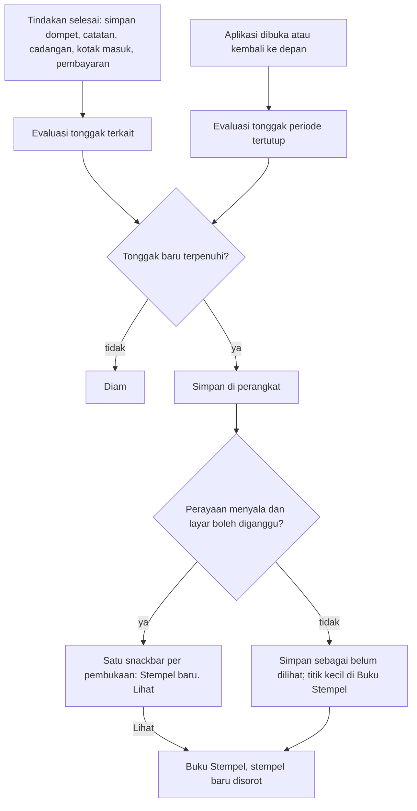
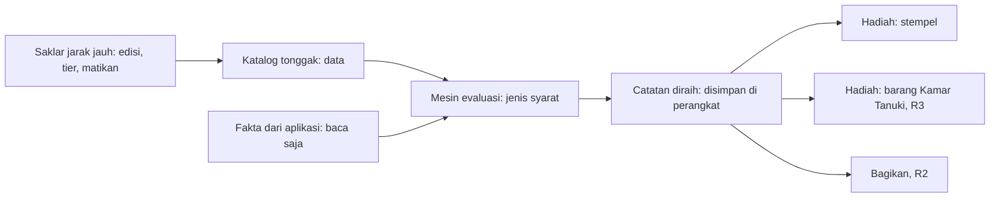

# Tonggak dan Buku Stempel: gamifikasi ringan yang bisa tumbuh

**Tanggal:** 11 November 2026.
**Status:** Draf, menunggu keputusan pemilik (§13). Belum dijadwalkan ke fase
(antrean B-94; B-81 dan B-82 menjadi lanjutannya).
**Berkaitan:** [FREEMIUM_PAYWALL.md](FREEMIUM_PAYWALL.md) §16 (aturan main
gamifikasi, B-81, B-82, KT-P16),
[RECURRING_AND_FORECAST.md](RECURRING_AND_FORECAST.md) §7A E12 dan KT-R13
(tanpa streak), [FEATURE_DISCOVERY.md](FEATURE_DISCOVERY.md) (penemuan fitur),
[APP_UPDATE.md](APP_UPDATE.md) (pola perayaan yang menunggu dan tidak
mengganggu), [EXPORT_BACKUP.md](EXPORT_BACKUP.md) (`BackupRegistry`).

**Revisi 12 Nov 2026:** ide "tutup buku periode", "Tanuki yang bereaksi", dan
rapor bercerita disatukan menjadi [BUKU_PERIODE.md](BUKU_PERIODE.md), seluruhnya
**Plus** (keputusan pemilik). Mesin tonggak dan stempel di dokumen ini tetap
**gratis** dan menjadi pengisi sampul buku bagi pengguna Plus: stempel periode
tercetak di sampul dan perayaannya dilipat ke ritual/rapor pada pembukaan yang
sama (BUKU_PERIODE BP-13). Stempel tetap menjadi satu-satunya mekanik
retensi untuk pengguna Gratis.

Dokumen ini merancang perilaku, aturan, dan teks: apa yang dialami pengguna
dan apa yang boleh tumbuh. Cara teknisnya diputuskan engineer (§12). Rupa
visual belum ada dan ditandai "perlu rupa dari ui-ux-designer".

## 1. Ringkasan keputusan (usulan)

1. **Satu mesin kecil, bukan banyak fitur.** Semua gamifikasi bertumpu pada
   satu hal: **tonggak** (hal nyata yang berhasil dilakukan pengguna) yang
   tercatat sekali dan disimpan di perangkat. Yang terlihat di R1 hanya
   **Buku Stempel** dan satu perayaan kecil.
2. **Yang dirayakan ketepatan dan kemampuan, bukan volume dan belanja.**
   Tidak ada tonggak yang berbunyi "N transaksi", "hemat", atau "belanja
   lebih sedikit". Aplikasi tidak menilai uang pengguna.
3. **Tidak ada streak, poin, level, skor, atau peringkat** (KT-R13, aturan
   FREEMIUM_PAYWALL §16.2). Tidak ada yang hilang atau mengecil saat pengguna
   tidak membuka aplikasi.
4. **Bisa dimatikan.** Satu sakelar di Akun mematikan perayaan dan pintu
   masuknya. Mesin tetap menyimpan diam-diam supaya tidak ada yang hilang bila
   dinyalakan lagi (G-8).
5. **Mudah diperluas tanpa membongkar yang lama.** Tonggak adalah data
   (katalog), syaratnya dari sedikit jenis syarat yang bisa ditambah, dan
   hadiahnya punya slot. Stempel musiman, tier Plus, bagikan, dan Kamar Tanuki
   menambah baris atau lapisan, bukan mengubah penyimpanan (§9).
6. **Dibangun dari yang sudah ada.** R1 memakai fakta yang sudah dihitung
   aplikasi (dompet, transaksi, periode, rutin, kotak masuk, cadangan) dan
   ikon clay yang sudah ada. Aset piksel pemilik (B-81, B-82) menyusul tanpa
   memblokir R1.

## 2. Masalah dan bukti

- **Pengguna baru berhenti sebelum kebiasaan terbentuk.** Tujuan produk
  (PRD §3) adalah pengguna kembali mencatat secara rutin. Di aplikasi pencatat
  keuangan, retensi minggu pertama biasanya terendah. Bukti di dalam
  proyek: riset gamifikasi di laporan bisnis pemilik 23 Okt 2026 (rujukan
  FREEMIUM_PAYWALL §16) yang menetapkan gamifikasi sebagai alat retensi
  versi gratis. *Asumsi sampai diukur:* belum ada angka aktivasi dan retensi
  sendiri. Peristiwa `wallet_created` dan `transaction_recorded` (B-93, sejak
  9 Nov 2026) baru mulai mengumpulkannya.
- **Banyak kemampuan bernilai tidak ditemukan atau tidak diselesaikan:**
  transaksi tanpa kategori membuat Analisis kurang tepat, kemunculan rutin
  dibiarkan menunggu, kotak masuk notifikasi menumpuk, data tidak pernah
  dicadangkan. Semuanya sudah punya fitur; yang kurang adalah alasan ringan
  untuk menyelesaikannya.
- **Pesaing memakai streak dan poin,** yang bertentangan dengan prinsip
  "lembut, bukan menghakimi" dan membuat pengguna merasa bersalah saat absen.
  Ruang yang kosong: pengakuan yang tidak menghukum.

## 3. Tujuan, non-tujuan, dan ukuran keberhasilan

**Tujuan**

1. Memberi pengakuan kecil dan tenang saat pengguna menyelesaikan sesuatu
   yang membuat catatannya lebih tepat atau datanya lebih aman.
2. Mengarahkan pengguna ke kemampuan yang belum mereka pakai, tanpa menekan.
3. Menyediakan satu fondasi yang menampung Buku Stempel musiman (B-82),
   kosmetik Plus (B-56), dan Kamar Tanuki (B-81) tanpa migrasi data.

**Non-tujuan (R1)**

- Kamar Tanuki, barang, kostum, edisi musiman, dan berbagi gambar (R2, R3).
- Menilai, membandingkan, atau memberi peringkat pengguna.
- Tonggak berbasis jumlah transaksi, besar nominal, atau kebiasaan harian.
- Notifikasi dorong untuk gamifikasi. Perayaan hanya muncul saat aplikasi
  sedang dibuka.
- Sinkronisasi stempel antarperangkat (mengikuti B-7).
- Aset piksel baru. R1 memakai ikon clay yang ada di bingkai stempel.

**Ukuran keberhasilan** (peristiwa di §10; ambang adalah usulan, ditetapkan
sesudah ada garis dasar dari B-93)

| Ukuran | Usulan | Cara mengukur |
|---|---|---|
| Pengguna baru yang masih mencatat di hari 14–28 | Naik ≥5 poin persentase pada kelompok dengan Buku Stempel | Uji A/B lewat Remote Config selama 4 minggu sesudah rilis, dua kelompok sama besar |
| Kemampuan yang terselesaikan | Pengguna dengan ≥1 stempel Rapi atau Aman bertambah | `milestone_earned` per `id` |
| Pengguna mematikan perayaan | <10% dari yang pernah melihat satu perayaan | `celebration_setting_changed{enabled:false}` |
| Keluhan nada | Nol keluhan "menekan" atau "kekanak-kanakan" dari penguji | Umpan balik closed testing |

## 4. Pengguna dan skenario

Semua nominal dalam rupiah; periode keuangan 25 Okt – 24 Nov 2026 (mulai
tanggal 25, gajian Rp8.500.000 cair 25 Okt).

**S1 — Mulai.** Rani memasang aplikasi, membuat dompet BCA dengan saldo
Rp4.250.000, lalu mencatat kopi Rp25.000. Sesudah menyimpan dompet, satu
snackbar lembut: "Stempel baru: Dompet pertama. [Lihat]". Sesudah catatan
pertama tersimpan di Catat, tidak ada pop-up di Catat; perayaan menunggu
dan tampil sekali di Beranda: "Stempel baru: Catatan pertama".

**S2 — Periode rapi.** Rani mencatat 12 transaksi di periode itu dan 12-nya
punya kategori. Pada 25 Nov ia membuka aplikasi; periode lama sudah tertutup
dan memenuhi syarat. Satu snackbar: "Stempel baru: Periode rapi. [Lihat]".

**S3 — Rutin tak terlewat.** Periode yang sama punya tiga rutin: kos
Rp1.200.000, internet Rp350.000, cicilan Rp2.914.000. Kos dan internet
dicatat, cicilan **dilewati** karena sudah lunas. Tidak ada kemunculan yang
masih menunggu, jadi "Rutin tak terlewat" diraih. Melewati sengaja dihitung
selesai: yang dihargai adalah keputusan, bukan kepatuhan.

**S4 — Dua stempel sekaligus.** Pada 25 Nov, S2 dan S3 sama-sama terpenuhi.
Aplikasi menampilkan **satu** snackbar "2 stempel baru. [Lihat]", bukan dua
(G-4).

**S5 — Terlambat tapi tetap dihargai.** Budi punya 14 transaksi periode itu,
2 belum berkategori. Tidak ada stempel Periode rapi. Seminggu kemudian ia
membuka Analisis, mengetuk **Beri kategori**, dan melengkapinya. Pada
pembukaan berikutnya Periode rapi diraih untuk periode lama itu. Tidak ada
yang dihukum karena terlambat.

**S6 — Absen.** Dodi tidak membuka aplikasi 40 hari. Saat kembali, Buku
Stempel persis seperti saat ia pergi; tidak ada kartu "kamu kehilangan".

**S7 — Pengguna lama.** Mira sudah memakai aplikasi tiga bulan dan punya
dompet, transaksi, dan satu cadangan. Pada pembukaan pertama sesudah
pembaruan, stempel yang sudah memenuhi syarat (Dompet pertama, Catatan
pertama, Cadangan pertama) **dimasukkan diam-diam** (G-6), lalu satu banner
lembut sekali: "Buku Stempel baru. Yang sudah kamu capai sudah ada di sini.
[Lihat]".

**S8 — Dimatikan.** Tono membuka Akun, mematikan **Perayaan stempel**. Tidak
ada snackbar lagi dan Buku Stempel tidak tampil di Akun. Tiga bulan kemudian
ia menyalakannya lagi dan semua stempel yang diraih selama itu ada.

## 5. Daftar tonggak R1

Delapan tonggak, semuanya dari fakta yang sudah ada di aplikasi. Tidak ada
yang bergantung pada fitur yang belum ada.

| Id | Nama (id / en) | Kelompok | Syarat | Dirayakan karena |
|---|---|---|---|---|
| `wallet_first` | Dompet pertama / First wallet | Mulai | Sedikitnya satu dompet aktif tersimpan | Kemampuan: tahu di mana uang berada |
| `record_first` | Catatan pertama / First record | Mulai | Sedikitnya satu transaksi tersimpan lewat Catat | Kemampuan: mencatat |
| `period_tidy` | Periode rapi / Tidy period | Rapi | Ada satu periode keuangan **sudah tertutup** dengan sedikitnya 3 transaksi dan **tanpa** transaksi tanpa kategori (transfer dan pemasukan freelance tanpa kategori tidak dihitung, sama seperti Analisis) | Ketepatan: Analisis akurat |
| `recurring_clear` | Rutin tak terlewat / Recurring all clear | Rapi | Ada satu periode tertutup dengan sedikitnya satu kemunculan rutin dan **tanpa** kemunculan berstatus Menunggu (Tercatat, Tertaut, dan Dilewati dihitung selesai) | Ketepatan: rencana sesuai kenyataan |
| `inbox_clear` | Kotak masuk bersih / Inbox cleared | Rapi | Kotak masuk Catat dari notifikasi turun dari ≥1 menunggu ke nol lewat keputusan pengguna (Catat, Bukan transaksi, atau Buang). Hanya Android | Ketepatan: kotak masuk ditinjau |
| `backup_first` | Cadangan pertama / First backup | Aman | Satu cadangan `.tkbak` berhasil dibuat dan disimpan atau dibagikan | Kemampuan: data aman |
| `budget_first` | Anggaran terpakai / Budget in use | Rencana | Satu anggaran punya sedikitnya satu pos dengan sedikitnya satu transaksi tertaut | Kemampuan: merencanakan |
| `freelance_paid` | Pembayaran pertama diterima / First payment received | Rencana | Satu pembayaran freelance dicatat diterima | Kemampuan: membedakan kerja selesai dan uang diterima |

Yang **sengaja tidak** ada di R1:

- "Saldo cocok" dan sejenisnya: fitur cocokkan saldo belum ada
  (KT-P16, ditunda).
- "Target tercapai": domain Target belum ada (B-47).
- Apa pun yang berbunyi hemat, di bawah anggaran, atau tanpa pengeluaran:
  menilai belanja pengguna.
- Apa pun berbasis hari berturut-turut atau jumlah catatan harian.

Tonggak yang butuh fitur yang belum dipakai pengguna (`inbox_clear`,
`freelance_paid`) tampil di Buku Stempel hanya sesudah fiturnya dipakai
sekali (KT-G3), supaya buku tidak terasa seperti daftar tugas.

## 6. Alur pengguna

1. **Titik masuk:** snackbar perayaan, Akun › Buku Stempel, dan banner
   pengenalan sekali untuk pengguna lama. Beranda tidak mendapat kartu
   tetap (KT-G4).
2. **Buku Stempel:** daftar stempel per kelompok (Mulai, Rapi, Aman,
   Rencana). Yang sudah diraih berwarna dengan tanggal ("Diraih 25 Nov").
   Yang belum tampil samar dengan satu baris cara mendapatkannya, tanpa
   hitungan dan tanpa "tinggal sekian".
3. **Perayaan:** snackbar v2 satu slot dengan aksi **Lihat**. Stempel
   pertama sepanjang masa mendapat lembar bawah pendek yang menjelaskan
   Buku Stempel dan sakelarnya, sekali saja.
4. **Jalan pulang:** menutup snackbar atau lembar tidak mengubah apa pun;
   stempel tetap diraih. Keluar dari Buku Stempel kembali ke Akun.

## 7. Aturan bisnis

| # | Aturan (bisa diuji) |
|---|---|
| G-1 | Stempel yang sudah diraih tidak pernah dicabut, dikurangi, atau kedaluwarsa, apa pun yang terjadi sesudahnya (data diubah atau dihapus, pengguna absen, fitur dimatikan). |
| G-2 | Tidak ada tonggak yang syaratnya berupa jumlah transaksi (di atas ambang minimal pencegah kebetulan di `period_tidy`), besar nominal, atau arah belanja. Tidak ada hari berturut-turut. |
| G-3 | Satu tonggak diraih paling banyak sekali. Mengulang syarat tidak memberi apa-apa lagi. |
| G-4 | Perayaan paling banyak **satu per pembukaan aplikasi**; yang lain digabung ("2 stempel baru") atau menunggu dengan titik kecil di Buku Stempel. Tidak pernah tampil di Catat, di dalam lembar lain, saat onboarding, atau saat tur spotlight. Banner pembaruan dan lembar Apa yang baru didahulukan. **Revisi 14 Nov 2026:** batas ini hanya untuk perayaan yang muncul sendiri. Gerak dan perayaan yang dipicu tindakan pengguna di dalam layar Buku Periode atau Kartu Periode (menyalakan stiker, mencap stempel, menutup buku, membagikan) tidak dihitung sebagai "satu per pembukaan" (BUKU_PERIODE BP-13); larangan di Catat, lembar lain, onboarding, dan tur tetap. |
| G-5 | Evaluasi berjalan lokal sesudah tindakan selesai atau saat aplikasi dibuka, tidak menunda tindakan atau pembukaan. Bila gagal atau terputus, tidak ada galat ke pengguna dan tidak ada stempel yang hilang: evaluasi berikutnya mengulang dan idempoten. |
| G-6 | Pada pembukaan pertama sesudah fitur ada, stempel yang sudah memenuhi syarat dimasukkan **tanpa perayaan satu per satu**; hanya satu banner pengenalan sekali. |
| G-7 | Stempel tidak pernah mengubah saldo, anggaran, rutin, atau data keuangan mana pun, dan tidak pernah membuka atau mengunci kemampuan inti. Aplikasi mencatat, bukan melakukan. |
| G-8 | Sakelar **Perayaan stempel** mati: tidak ada snackbar atau lembar, dan Buku Stempel tidak tampil di Akun. Evaluasi dan penyimpanan tetap berjalan diam-diam; menyalakan lagi menampilkan semuanya, tanpa perayaan ulang untuk yang sudah ada. |
| G-9 | Teks dan gambar yang bisa dibagikan (R2) tidak memuat nominal, nama dompet, atau nama kategori buatan pengguna. Berlaku untuk bagikan stempel; **Kartu Periode** (BUKU_PERIODE) boleh memuat nominal atas pilihan pengguna sesuai keputusan pemilik 12 Nov 2026. |
| G-10 | Stempel dan sakelar adalah milik perangkat (ADR-024). Ikut cadangan dan pemulihan; pemulihan mengganti stempel bersama data lain, tanpa penggabungan. |
| G-11 | Kemampuan inti tetap berfungsi penuh tanpa koneksi dan tanpa akun; Buku Stempel juga, kecuali saklar jarak jauh dan edisi musiman yang menunggu koneksi (R2). |

Yang perlu diingat aplikasi: stempel yang diraih (id, tanggal, sudah
dilihat atau belum), sakelar perayaan, dan penanda pengenalan sudah tampil.
Bukan data keuangan dan bukan entitas domain keuangan; DOMAIN_MODEL tidak
berubah, tetapi **penyimpanannya wajib didaftarkan di `BackupRegistry`**
(CLAUDE.md, Fase 22), jadi G-10 bisa diuji.

## 8. Kebutuhan informasi per layar

**Buku Stempel** (perlu rupa dari ui-ux-designer; Akun › Buku Stempel):

1. Judul dan satu kalimat penjelas ("Stempel kecil untuk hal yang berhasil
   kamu lakukan. Tidak ada yang hilang.").
2. Daftar per kelompok: stempel (ikon dalam bingkai), nama, tanggal diraih
   atau satu baris cara mendapatkannya.
3. Titik kecil pada stempel yang belum dilihat; hilang begitu buku dibuka.
4. Tanpa judul "n dari N", tanpa bilah progres, tanpa urutan peringkat
   (KT-G1).
5. Keadaan: kosong (belum ada stempel; ajakan lembut menuju Dompet pertama),
   memuat, sebagian diraih, semua diraih ("Semua stempel yang ada sudah
   kamu raih. Yang baru akan datang bersama fitur baru.").

**Perayaan:** snackbar satu kalimat + aksi Lihat; satu lembar bawah
pengenalan sekali (judul, dua kalimat manfaat, tombol Oke, tautan ke
sakelar).

**Akun:** satu baris **Buku Stempel** (hilang bila sakelar mati) dan satu
baris sakelar **Perayaan stempel** dengan keterangan. Posisi di grup
Aplikasi, dekat Versi aplikasi.

## 9. Titik perluasan (yang membuat ini bisa tumbuh)

Lima lapisan yang berdiri sendiri. Menambah sesuatu hanya menyentuh
lapisan yang relevan.

| Mau menambah | Yang berubah | Yang tidak berubah |
|---|---|---|
| Stempel biasa baru | Satu baris katalog + teks id/en | Penyimpanan, mesin |
| Edisi musiman (Ramadan, 17 Agustus, Tahun Baru; B-82) | Baris katalog dengan jendela tanggal; jendela dan saklar dari Remote Config | Penyimpanan; stempel lama |
| Stempel khusus Plus (B-56) | Penanda tier di baris katalog; digerbang lewat `Entitlements` yang ada | Aturan G-1..G-11 |
| Jenis syarat baru (mis. "target tercapai" saat B-47 ada, "saldo cocok" saat KT-P16 dibuka) | Satu jenis syarat dan satu fakta baru | Katalog lama, penyimpanan |
| Hadiah baru (barang Kamar Tanuki, kostum; B-81) | Lapisan hadiah yang membaca daftar diraih | Penyimpanan; tidak perlu migrasi |
| Bagikan stempel (R2) | Perender gambar tanpa nominal (G-9) | Mesin, katalog |
| Matikan satu tonggak yang bermasalah | Saklar jarak jauh | Rilis aplikasi |

Jenis syarat yang ada di R1 (kosakata, bukan rancangan kode):

- **Pertama kali:** suatu fakta menjadi benar untuk pertama kali
  (`wallet_first`, `record_first`, `backup_first`, `budget_first`,
  `freelance_paid`).
- **Periode tertutup memenuhi:** ada satu periode keuangan yang sudah
  tertutup dan memenuhi syarat atas isinya (`period_tidy`,
  `recurring_clear`).
- **Antrean bersih:** suatu antrean turun dari ada ke kosong lewat tindakan
  pengguna (`inbox_clear`).

## 10. Analitik

Lewat `AppAnalytics`, kelas baru `MilestoneEvents`, tanpa nominal, tanggal,
atau teks pengguna; id hanya dari kosakata tetap di §5.

| Peristiwa | Parameter | Kapan |
|---|---|---|
| `milestone_earned` | `id`, `quiet: true\|false` (true = pemasukan diam-diam G-6) | Stempel diraih |
| `stamp_book_viewed` | `source: account\|celebration\|intro` | Buku Stempel dibuka |
| `celebration_setting_changed` | `enabled` | Sakelar diubah |
| `milestone_celebration_shown` | `count` (1 atau lebih bila digabung) | Perayaan tampil |

**Tanpa uji A/B** (keputusan pemilik 14 Nov 2026, KT-G6): semua pengguna
mendapat stempel. Parameter Remote Config `stamps_enabled` tetap ada hanya
sebagai saklar mati jarak jauh. Ukuran di §3 dibaca dari tren sebelum/sesudah
rilis, bukan dari kelompok pembanding.

## 11. Privasi dan Keamanan Data

- Stempel disimpan di perangkat dan tidak dikirim ke mana pun.
- Peristiwa §10 memakai id tetap dan angka kecil; termasuk kategori "Aktivitas
  aplikasi / Interaksi aplikasi" yang sudah dideklarasikan
  ([PLAY_DATA_SAFETY.md](../../03-release/PLAY_DATA_SAFETY.md)), bukan jenis
  data baru. Tetap dicek di T-27.x terakhir.
- Saklar jarak jauh memakai Remote Config yang sudah ada (ADR-039); tidak ada
  server baru.
- R2: gambar bagikan tidak memuat data keuangan atau identitas (G-9).

## 12. Diserahkan ke engineer

Keputusan teknis berikut sengaja tidak diputuskan di sini. Engineer menulis
ADR baru (nomor berikutnya, Proposed sampai pemilik menyetujui) sebelum kode:

1. **Letak kode dan batas** (ADR-030): zona untuk katalog, mesin, dan
   penyimpanan; fitur apa yang menyediakan fakta tanpa mesin mengimpor isi
   fitur lain (mis. lewat akar komposisi `lib/app/`).
2. **Sumber katalog:** di dalam kode (ikut rilis dan pembaruan kecil) atau
   dari Remote Config, atau gabungan (definisi di kode, jendela dan saklar
   dari Remote Config). Usulan PO: gabungan, karena ADR-039 menunjukkan
   catatan lewat Remote Config perlu penanganan keandalan, sedangkan syarat
   tonggak adalah logika.
3. **Pemicu evaluasi:** sinyal apa yang dipakai (mis. `LedgerChanges`,
   peristiwa aplikasi dibuka) dan bagaimana menjaganya idempoten dan murah
   (G-5).
4. **Penyimpanan dan cadangan:** kunci Hive baru dan pendaftaran
   `BackupRegistry`; versi skema untuk jenis hadiah baru (G-10).
5. **Antarmuka hadiah:** bentuk slot hadiah supaya R2/R3 menambah jenis tanpa
   migrasi.
6. **Pengenalan pengguna lama** (G-6): cara memasukkan stempel yang sudah
   memenuhi syarat tanpa perayaan.

Batasan yang wajib dipenuhi pilihan apa pun: aturan G-1–G-11, tanpa data
keuangan keluar perangkat, inti tetap luring dan tidak melambat, bisa diuji
tanpa perangkat (fakta dan jam bisa diganti palsu), dan perayaan memakai
slot snackbar v2 yang ada. Bila sebuah batasan tidak bisa dipenuhi, berhenti
dan lapor ke pemilik.

## 13. Kata dan kalimat (id / en)

Kunci diusulkan di namespace `stamps.*`; tunduk pada `writing.md` dan
glosarium ("kamu", tanpa tanda seru, tanpa "level", "poin", "streak",
"badge", "misi").

| Kunci | id | en |
|---|---|---|
| `stamps.title` | Buku Stempel | Stamp Book |
| `stamps.intro` | Stempel kecil untuk hal yang berhasil kamu lakukan. Tidak ada yang hilang. | Small stamps for things you managed to do. Nothing is ever lost. |
| `stamps.celebration.one` | Stempel baru: $name | New stamp: $name |
| `stamps.celebration.many` | $count stempel baru | $count new stamps |
| `stamps.celebration.action` | Lihat | View |
| `stamps.firstSheet.title` | Buku Stempel | Stamp Book |
| `stamps.firstSheet.body` | Setiap kali kamu menguasai hal baru atau merapikan catatan, satu stempel masuk ke sini. Tidak ada target harian dan tidak ada yang berkurang. Kamu bisa mematikannya kapan saja di Akun. | Whenever you learn something new or tidy up your records, a stamp lands here. No daily goals, and nothing ever goes down. You can turn it off anytime in Account. |
| `stamps.legacyBanner` | Buku Stempel baru. Yang sudah kamu capai sudah ada di sini. | A new Stamp Book. What you already did is here. |
| `stamps.earnedOn` | Diraih $date | Earned $date |
| `stamps.empty.title` | Belum ada stempel | No stamps yet |
| `stamps.empty.body` | Buat dompet pertamamu dan stempel pertama akan masuk ke sini. | Create your first wallet and your first stamp lands here. |
| `stamps.allDone` | Semua stempel yang ada sudah kamu raih. Yang baru datang bersama fitur baru. | You have every stamp so far. New ones arrive with new features. |
| `stamps.setting.label` | Perayaan stempel | Stamp celebrations |
| `stamps.setting.hint` | Tampilkan kabar kecil saat kamu meraih stempel. | Show a small note when you earn a stamp. |
| `stamps.wallet_first.name` | Dompet pertama | First wallet |
| `stamps.wallet_first.how` | Buat satu dompet. | Create a wallet. |
| `stamps.record_first.name` | Catatan pertama | First record |
| `stamps.record_first.how` | Catat satu transaksi. | Record a transaction. |
| `stamps.period_tidy.name` | Periode rapi | Tidy period |
| `stamps.period_tidy.how` | Satu periode yang sudah lewat, semua transaksinya berkategori. | A past period with every transaction categorized. |
| `stamps.recurring_clear.name` | Rutin tak terlewat | Recurring all clear |
| `stamps.recurring_clear.how` | Satu periode yang sudah lewat, semua kemunculan rutin sudah dicatat, ditautkan, atau dilewati. | A past period where every recurring occurrence was recorded, linked, or skipped. |
| `stamps.inbox_clear.name` | Kotak masuk bersih | Inbox cleared |
| `stamps.inbox_clear.how` | Tinjau semua yang menunggu di kotak masuk notifikasi. | Review everything waiting in the notification inbox. |
| `stamps.backup_first.name` | Cadangan pertama | First backup |
| `stamps.backup_first.how` | Simpan satu cadangan dari Akun. | Save a backup from Account. |
| `stamps.budget_first.name` | Anggaran terpakai | Budget in use |
| `stamps.budget_first.how` | Tautkan satu transaksi ke pos anggaran. | Link a transaction to a budget item. |
| `stamps.freelance_paid.name` | Pembayaran pertama diterima | First payment received |
| `stamps.freelance_paid.how` | Catat satu pembayaran freelance yang sudah diterima. | Record a freelance payment you received. |

Istilah baru masuk glosarium: **Stempel**, **Buku Stempel**, **Tonggak**.

## 14. Kasus tepi

| Kasus | Perilaku |
|---|---|
| Transaksi dihapus sesudah stempel diraih | Stempel tetap (G-1). |
| Periode tertutup mendapat transaksi tanpa kategori baru (impor, notifikasi lama) sesudah `period_tidy` diraih | Stempel tetap; yang dinilai saat pertama terpenuhi. |
| Dompet pertama dihapus lalu dibuat lagi | Tidak ada perayaan kedua (G-3). |
| Pemulihan dari cadangan memuat stempel lebih sedikit | Stempel diganti sesuai cadangan (G-10); tonggak yang kini terpenuhi oleh data dipulihkan dimasukkan diam-diam. |
| Pemulihan dari cadangan lama sebelum fitur ini | Tidak ada stempel di cadangan; evaluasi memasukkan yang terpenuhi diam-diam (G-6). |
| Dua tonggak terpenuhi sekaligus | Satu perayaan digabung (G-4). |
| Perayaan akan tampil saat banner pembaruan atau lembar Apa yang baru aktif | Perayaan menunggu; titik kecil di Buku Stempel. |
| Penyimpanan stempel gagal dibaca | Anggap belum ada; evaluasi memasukkan ulang diam-diam; tanpa galat dan tanpa perayaan massal. |
| iOS atau perangkat tanpa Catat dari notifikasi | `inbox_clear` tidak tampil di buku. |
| Stempel tidak lagi ada di katalog (dimatikan lewat saklar) | Yang sudah diraih tetap tampil; yang belum diraih disembunyikan. |
| Mode gelap, sembunyikan nominal, bahasa diganti | Tidak berpengaruh pada isi; teks mengikuti bahasa (§13). |
| Perangkat dengan jam salah | Tanggal diraih memakai jam perangkat; tidak mempengaruhi syarat (periode tertutup dihitung dari tanggal transaksi). |

## 15. Fase rilis dan usulan tugas

- **R1 (B-94):** mesin, delapan tonggak, Buku Stempel, perayaan, sakelar,
  saklar jarak jauh, analitik, uji A/B. Ikon clay di bingkai stempel; tanpa
  aset baru.
- **R2 (B-82):** edisi musiman (jendela tanggal dari Remote Config), tier
  Plus, bagikan stempel tanpa nominal, aset piksel pemilik.
- **R3 (B-81):** Kamar Tanuki membaca daftar diraih; barang dan kostum;
  kosmetik Plus (B-56).

Usulan pemecahan R1 (belum masuk TASK_LIST; dijadwalkan sesudah pemilik
menaikkan B-94 ke fase):

| Usulan | Isi | Ukuran | Butuh |
|---|---|---|---|
| T-28.1 | ADR teknis (§12) | S | KT-G1–G6 dijawab |
| T-28.2 | Katalog, jenis syarat, mesin evaluasi, penyimpanan + `BackupRegistry` | M | T-28.1 |
| T-28.3 | Penyedia fakta dari dompet, transaksi, periode, rutin, kotak masuk, cadangan, anggaran, freelance | M | T-28.1 |
| T-28.4 | Perayaan (snackbar, lembar pengenalan, banner pengguna lama) dan aturan G-4/G-6 | M | T-27.2, rupa |
| T-28.5 | Buku Stempel dan baris/sakelar di Akun | M | T-27.2, rupa dari ui-ux-designer |
| T-28.6 | Analitik §10, saklar jarak jauh `stamps_enabled` (tanpa uji A/B) | S | T-27.4, T-27.5 |
| T-28.7 | Teks id/en, glosarium, dokumen rilis | S | T-28.5 |
| T-28.8 | Verifikasi perangkat: S1–S8 | S | semua |

## 16. Pertanyaan untuk pemilik

**Diputuskan pemilik 14 Nov 2026:** semua rekomendasi disetujui (KT-G1–G5,
G7), **kecuali KT-G6: tanpa uji A/B**. Dijadwalkan sebagai Fase 28
(T-28.1–T-28.8) di TASK_LIST, dikerjakan sebelum Fase 27 karena Buku Periode
membaca fakta "periode tertutup" dari mesin ini. Daftar di bawah dibiarkan
sebagai catatan alasan.

- **KT-G1 — Tampilkan "n dari N"?** Rekomendasi: **tidak.** Hitungan koleksi
  mudah terbaca sebagai skor dan mengundang "tinggal satu lagi"; yang
  tampil hanya stempel.
- **KT-G2 — Bentuk perayaan.** Rekomendasi: **snackbar satu slot dengan aksi
  Lihat**, plus satu lembar pengenalan sekali. Lebih tenang daripada lembar
  penuh tiap kali dan tidak berebut dengan banner pembaruan.
- **KT-G3 — Stempel fitur yang belum dipakai.** Rekomendasi: **tampil samar
  hanya sesudah fiturnya dipakai sekali** (`inbox_clear`, `freelance_paid`);
  stempel inti (Mulai, Rapi, Aman) selalu tampil samar dengan caranya.
  Alternatif: semua tampil dari awal, lebih menemukan fitur tetapi terasa
  seperti daftar tugas.
- **KT-G4 — Pintu masuk.** Rekomendasi: **Akun › Buku Stempel** saja di R1.
  Tile di Beranda (aksi cepat) ditinjau di R3 bersama Kamar Tanuki. Menambah
  pintu di Beranda mengubah arsitektur informasi dan menambah gangguan.
- **KT-G5 — Isi daftar R1.** Rekomendasi: delapan tonggak §5. Pemilik boleh
  menambah atau mengurangi; yang tidak disarankan: apa pun yang menilai
  belanja.
- **KT-G6 — Uji A/B dan ambang.** Rekomendasi: aktifkan `stamps_enabled`
  untuk 50% pengguna baru selama 4 minggu; ambang "naik ≥5 poin" ditetapkan
  sesudah garis dasar dari B-93 ada.
- **KT-G7 — Pengguna lama.** Rekomendasi: masukkan diam-diam dengan satu
  banner (G-6), bukan perayaan satu per satu.

## 17. Yang sengaja tidak dikerjakan

- Streak, poin, level, skor, peringkat, papan skor, misi harian.
- Notifikasi dorong tentang stempel atau "kamu belum membuka".
- Hadiah yang bisa dibeli atau ditukar dengan uang; stempel tidak punya nilai
  tukar.
- Perbandingan antarpengguna dan berbagi publik di dalam aplikasi.
- Tonggak yang menilai belanja, tabungan, atau kebiasaan.
